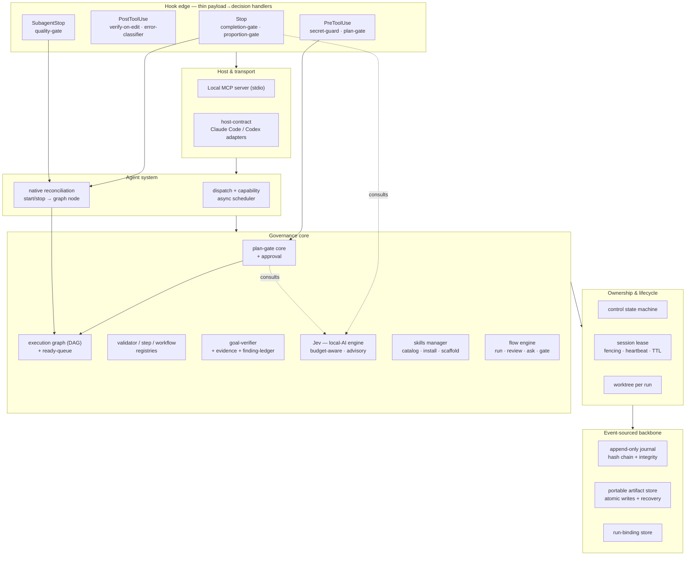
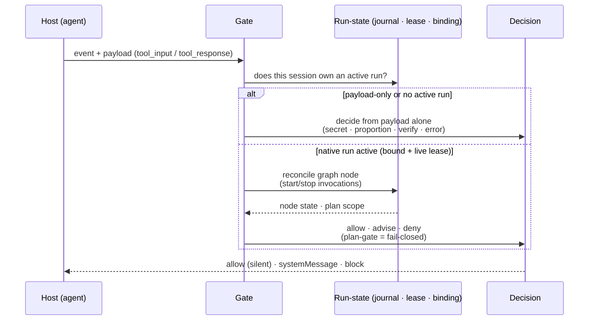

<p align="center">
  
</p>

<p align="center">
  
  
  
  
  
  
  
</p>

<h1 align="center">Gatewright</h1>

<p align="center">
  <strong>Guardrails that keep AI coding agents inside the lines — versioned in your repo, deterministic, and auditable.</strong>
</p>

<p align="center">
  Gatewright wraps agents like <em>Claude Code</em> and <em>Codex</em> in a set of repo-local <strong>gates</strong> —
  scope control, completion verification, diff proportion, secret protection, handoff quality, budget —
  so an agent stays on task instead of drifting. It ships as a CLI (<code>gate</code>) with an interactive TUI,
  a local <strong>MCP server</strong>, and an <strong>event-sourced core</strong> that makes every decision replayable.
</p>

---

## The problem

Leave a coding agent alone and it drifts. Scope creeps past what you asked for. Diffs balloon.
Verification gets skipped — no typecheck, no tests. Secrets get slurped into context. Token budgets
go unwatched. And every new prompt re-explains the same project conventions from scratch.

The usual fix is a human babysitting the agent, approving each step by hand. That doesn't scale, and
it isn't repeatable — the "rules" live in one person's head.

## The idea

**Turn that discipline into code that lives in your repo.** A gate is a pure
`payload → decision` function: given a lifecycle event (a tool call, a stop, a subagent handoff), it
returns **allow**, **advise**, or **deny** — with no side effects. Because gates are plain, testable
functions versioned alongside the project they protect, the rules are explicit, reviewable, and the
same for every agent and every teammate.

Underneath, an **append-only, hash-chained journal** records every event, so no decision is a black
box: you can audit it, replay it, and recover from a crash deterministically.

Gatewright is an original design, built from the ground up in TypeScript. It is **headless-first** —
no editor coupling, no UI required — just a binary and a server you wire into your agent's hooks. An
interactive TUI sits on top for when you'd rather drive it by hand.

---

## What you get

- 🚦 **Seven shipped gates** covering scope, verification, proportion, secrets, errors, completion, and handoffs.
- 🧭 **Guided end-to-end flows** — run a whole SDD cycle (plan → *you review* → implement → PR) with human gates between steps.
- 🧠 **Jev, a local-AI advisor** — optional, budget-aware, local-first judgment for the fuzzy calls a rule can't settle. It *advises*; it never hard-blocks.
- 🔌 **Local MCP server** — exposes the gate catalog and checks as MCP tools your agent can call.
- 📼 **Event-sourced core** — hash-chained journal, portable artifact store, run-binding, crash recovery, replay.
- 🗂️ **31 curated skills** — reusable SKILL.md playbooks (SDD, code review, debugging, refactors, …) injected into runs.
- 🖥️ **Interactive TUI** — configure, provision, run, review history, and roll back without memorizing a single subcommand.
- 🌳 **Worktree-per-run isolation**, session leases with fencing, and native reconciliation of the agent's own tool calls.

---

## Core principles

| Principle | What it means |
|-----------|---------------|
| **Deterministic & auditable** | Every event is appended to a hash-chained journal. Nothing is a black box — you can replay any run. |
| **Fail-open by default** | Gates never break your agent on a hiccup. Only a deliberate scope/plan rule is allowed to **fail-closed** and block. |
| **Advisory AI, never silent blocking** | The local-AI engine (**Jev**) only *advises* the human gate. It can never hard-block on a non-deterministic hunch. |
| **Human-in-the-loop** | Guided flows stop and show you what the agent produced — the plan, the diff — before you approve the next step. |
| **Composable** | Big gates are assembled from small, reusable atomic validators. |
| **Repo-local** | Config, gates, skills, and history live in your project. Portable, versionable, reviewable. |

---

## The gates

| Gate | Event | What it does |
|------|-------|--------------|
| **secret-guard** | `PreToolUse` | Blocks reading secret files into context (env files, keys, certs). A clean-room static analyzer: it tells reader verbs (`cat`/`grep`) from movers (`cp`/`mv`) and exempts template variants like `.env.example`. |
| **plan-gate** | `PreToolUse` | Blocks in-workspace mutations outside the approved plan's scope. The one gate that **fails closed**. |
| **verify-on-edit** | `PostToolUse` | Flags merge-conflict markers, stray `debugger;`, and missing tests after an edit. Advisory. |
| **error-classifier** | `PostToolUse` | Classifies command failures into actionable remediations (missing module, wrong cwd, …). Never blocks. |
| **proportion-gate** | `Stop` | Over-reach sensor: warns when a turn's diff is disproportionate to the task. |
| **completion-gate** | `Stop` | Enforces run completion via native reconciliation; fails open when off that flow. |
| **quality-gate** | `SubagentStop` | Gates subagent handoffs — native reconciliation, or a handoff-quality heuristic. |

Gates of judgment (proportion / completion / plan) can optionally consult **Jev** and attach an
*Action Card* to their message — advisory input for the human reviewer that never changes the
deterministic decision.

---

## Guided flows

Beyond per-event gating, Gatewright can drive an agent through a whole **spec-driven development
cycle** as one orchestrated flow, with human gates between steps:

```
run (plan)  →  REVIEW  →  gate (sign off?)  →  run (implement)  →  …  →  PR
```

Each step is one of three kinds — a **run** (spawn the agent headless, stream its work live), an
**ask** (the agent emits a `<gate-ask>` block when it needs a human to disambiguate), or a **gate**
(a sign-off you approve or decline). Before any gate or ask, Gatewright shows a **scrollable review
of what the agent just produced** — the plan, its reasoning — so you actually read what you're
approving instead of rubber-stamping it. Decline a gate and the flow stops cleanly.

The live run view is OpenCode-style: a scrollable viewport, tool targets, cleaned markdown, and the
AI's answer rendered in full. You can leave any screen and return to the dashboard at any time.

---

## Jev — local-AI advisory

**Jev** is an optional judgment layer for the fuzzy cases a deterministic rule can't settle — the
real proportion of a diff, the quality of a handoff, scope disambiguation. It is:

- **Local-first** — talks to Ollama or LM Studio over HTTP. Nothing leaves your machine.
- **Budget-aware** — a per-feature quota caps how much it's consulted.
- **Advisory only** — every verdict is `approve` / `discard` / `abstain`, never a hard block, and all of it is logged to the journal.
- **Zero-install** — Jev installs nothing. Helper scripts detect an already-running local endpoint and write the config Gatewright reads.

```sh
python3 scripts/jev/detect.py                       # probe Ollama / LM Studio
python3 scripts/jev/configure.py --auto-detect \
        --enabled true --budget proportion-gate=20   # write jev.config.json
```

You can also configure it at runtime through the MCP tool `configure_jev`. Jev defaults to
**disabled** — an unconfigured Jev is a safe no-op. (Timeout defaults to 30s, enough for a local 7B
model to respond rather than always abstaining.)

---

## The TUI

Run `gate` with no arguments and you get an interactive home screen — no subcommands to memorize.
From the dashboard you can:

| Action | What it does |
|--------|--------------|
| **Flow** | Run an end-to-end SDD → review → PR cycle with human gates. |
| **Run an agent** | Launch an agent through the gate, with skills injected. |
| **Skills** | Browse the gate's curated skill catalog. |
| **Configure this project** | Wire the gates into the project's hooks. |
| **Settings** | Choose gate-wide vs per-project scope. |
| **Install / provision** | Set up Ollama · LiteLLM · a custom endpoint, with a live step log. |
| **Fix pending items** · **Set up dogfood** | Repair config / configure Gatewright to govern its own development. |
| **History** · **Rollback a change** | Review past runs and undo a change. |

Every screen is also a subcommand for scripting (`gate doctor`, `gate history`, `gate skills`, …),
and the read-only ones print plain text so they're headless-friendly.

---

## Install

> Gatewright is in **alpha** and runs from source — there's no published package yet.

**Requirements:** Node ≥ 22 and git. (Jev additionally wants a local LLM endpoint — Ollama or
LM Studio — but installs nothing itself.)

```sh
git clone https://github.com/rfsants001/gatewright.git
cd gatewright
npm install
npm run build
npm start        # launches the interactive home screen
```

Expose the `gate` binary on your PATH (optional):

```sh
npm link         # now `gate` is available globally
gate --version   # gate 0.1.0
gate --help
```

You can also run it directly (`node dist/cli/gate.js [command]`) or in watch mode (`npm run dev`).

### Uninstall

```sh
npm unlink -g gatewright     # remove the global `gate` binary (if you linked it)
rm -rf ~/.gatewright         # remove gate-wide config, sessions and runs
```

Per-project state lives in each repo's `.gatewright/` and `.specs/` — delete those folders to
remove Gatewright from a project. Hooks/MCP it wrote into a host (e.g. `.claude/settings.json`,
`.mcp.json`) can be reverted with `gate rollback` or removed by hand.

---

## Wire it into your agent

### 1. Hook the gates into lifecycle events

Gatewright reads a hook event as JSON on stdin and replies on stdout. For Claude Code, point each
lifecycle hook at `gate hook` (e.g. in `.claude/settings.json`):

```jsonc
{
  "hooks": {
    "PreToolUse":   [{ "hooks": [{ "type": "command", "command": "gate hook" }] }],
    "PostToolUse":  [{ "hooks": [{ "type": "command", "command": "gate hook" }] }],
    "Stop":         [{ "hooks": [{ "type": "command", "command": "gate hook" }] }],
    "SubagentStop": [{ "hooks": [{ "type": "command", "command": "gate hook" }] }]
  }
}
```

A silent exit means *allow*; a `systemMessage` injects advice; a block decision stops the action.
(The **Configure this project** screen writes this for you.)

### 2. Run the MCP server

Expose the gate catalog and checks as MCP tools (`list_gates`, `check_gate`, `configure_jev`,
`get_jev_config`) over stdio:

```sh
gate serve
```

Register it with your agent (e.g. `.mcp.json`):

```jsonc
{
  "mcpServers": {
    "gatewright": { "command": "gate", "args": ["serve"] }
  }
}
```

### 3. Manage skills

```sh
gate skill list              # list skills in ./skills (or $GATEWRIGHT_SKILLS_DIR)
gate skill new my-skill      # scaffold a SKILL.md + references/ folder
```

### Environment

| Variable | Purpose | Default |
|----------|---------|---------|
| `GATEWRIGHT_SESSIONS_DIR` | Session / run state root | `~/.gatewright/sessions` |
| `GATEWRIGHT_SKILLS_DIR` | Skills catalog root | `./skills` |
| `GATEWRIGHT_JEV_CONFIG` | Jev config file path | `~/.gatewright/jev.config.json` |

---

## Architecture

Gatewright is layered: a thin edge of hooks sits on top of a host/transport layer, an agent system,
a governance core, ownership primitives, and an event-sourced backbone that everything depends on.



### How a gate decides



---

## Project layout

```
src/
  cli/        gate — CLI entrypoint (hook · serve · skill · screens)
  ui/         Ink TUI — dashboard, flow, run-composer, run-live, provision, history, settings
  core/
    journal/        append-only hash-chained event log
    artifact-store/ atomic, crash-safe persistence
    run-binding/    session → run index
    control/        control state machine
    lease/          session lease (fencing · heartbeat · TTL)
    gate/           gate contract + engine + registry
    graph/          execution graph (DAG, ready-queue)
    plan/           plan-gate + scope evaluation
    scope/          module dependency graph + boundaries
    agent/          registry · capability · dispatch scheduler
    reconcile/      native invocation store · reconciler
    jev/            local-AI decision engine (advisory)
    validators/     atomic validators + step/workflow registries
    goal/           finding-ledger · evidence · goal-verifier
    skills/         SKILL.md · catalog · scaffold
    flow/           flow engine + SDD flow + <gate-ask> questions
    worktree/       run → git worktree
  gates/      the shipped gates
  host/       host-contract + Claude Code adapter
  mcp/        MCP server
skills/       31 curated SKILL.md playbooks
scripts/jev/  local-endpoint detection & configuration (Python)
```

---

## Development

```sh
npm run typecheck     # tsc --noEmit (strict, NodeNext ESM)
npm test              # vitest — 349 tests
npm run build         # emit dist/
```

TypeScript, ESM, Vitest. The suite is fast and hermetic — no external services (Jev is tested with a
deterministic stub and a mocked fetch; git-dependent features use a throwaway repo).

Workflow: spec-driven development (specs under `.specs/`, local to the repo) + GitHub Flow —
one feature per branch off `main`, one PR, human review is the merge gate. Gatewright **dogfoods
itself**: it governs its own development through the same gates it ships.

---

## License

Released under the **MIT License**. Curated skills adapted from third-party sources retain their
original attribution (see `skills/NOTICE.md`).
