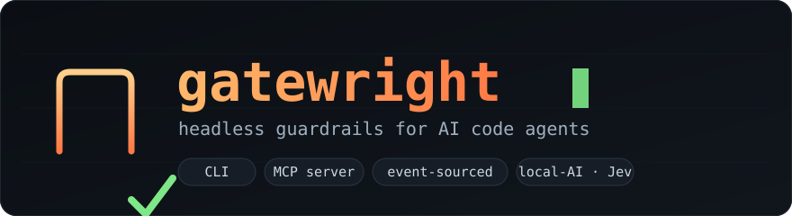
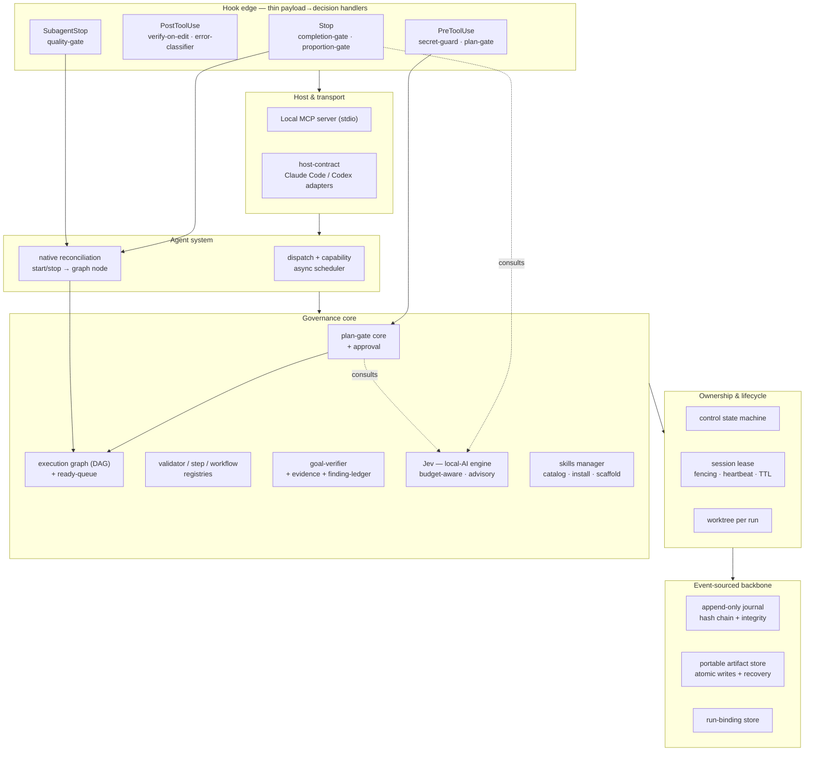
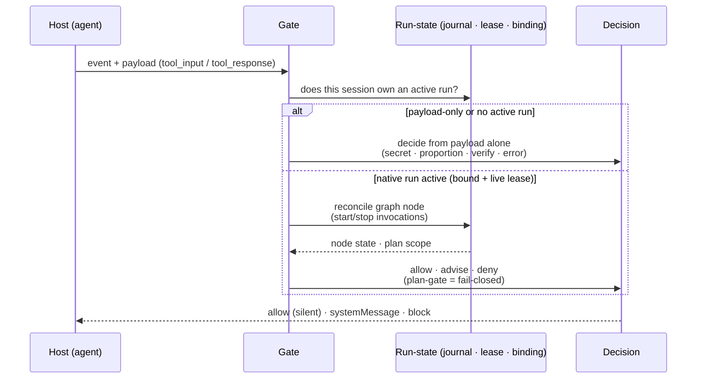
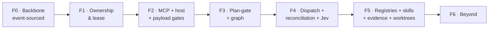

<p align="center">
  
</p>

<p align="center">
  
  
  
  
  
  
</p>

# Gatewright

**Gatewright is an open-source, headless governance layer for AI code agents.** It gives agents
like Claude Code and Codex a set of versioned, repo-local **gates** — scope control, completion
verification, diff proportion, secret protection, handoff quality, budget — so an agent stays
inside the lines instead of drifting. It ships as a CLI (`gate`) and a local **MCP server**, backed
by an **event-sourced core** that makes every decision deterministic, auditable, and replayable.

Gatewright is an original design, built from the ground up in TypeScript. It is **headless-first**:
no editor coupling, no UI required — just a binary and a server you wire into your agent's hooks.

---

## Why

Coding agents drift when left alone: scope creeps, diffs balloon, verification gets skipped (no
typecheck, no tests), secrets get read into context, token budgets go unwatched, and project
conventions get re-explained every prompt. Gatewright turns that discipline into **code that lives
in your repo** — a gate is a pure `payload → decision` function, so the rules are explicit,
testable, and versioned alongside the project they protect.

- **Deterministic & auditable** — an append-only, hash-chained journal records every event; nothing
  is a black box.
- **Fail-open by default, fail-closed where it matters** — gates never break your agent unless a
  scope/plan rule is deliberately set to block.
- **Advisory AI, never silent blocking** — the optional local-AI engine (**Jev**) only *advises* the
  human gate; it can never hard-block on a non-deterministic hunch.
- **Composable** — big gates are built from small, reusable atomic validators.

---

## Architecture

Gatewright is layered: a thin edge of hooks sits on top of a host/transport layer, an agent system,
a governance core, ownership primitives, and an event-sourced backbone that everything depends on.



### How a gate decides



---

## The gates

| Gate | Event | Role |
|------|-------|------|
| **secret-guard** | PreToolUse | Blocks reading secret files into context (env files, keys, certs). |
| **plan-gate** | PreToolUse | Blocks in-workspace mutations outside the approved plan's scope (fail-closed). |
| **verify-on-edit** | PostToolUse | Flags merge markers, stray `debugger;`, and missing tests after an edit. |
| **error-classifier** | PostToolUse | Classifies command failures into actionable remediations. Never blocks. |
| **proportion-gate** | Stop | Over-reach sensor: warns when a turn's diff is disproportionate. |
| **completion-gate** | Stop | Enforces run completion via native reconciliation; fails open off that flow. |
| **quality-gate** | SubagentStop | Gates subagent handoffs (native reconciliation, or a handoff-quality heuristic). |

Gates of judgment (proportion / completion / plan) can optionally consult **Jev** and attach an
*Action Card* to their message — advisory input for the human reviewer, which never changes the
deterministic decision.

---

## Install

> There is no published package or install script yet — Gatewright is built and run from source.

**Requirements:** Node ≥ 22, git. (Jev additionally needs a local LLM endpoint — Ollama or
LM Studio — but installs nothing itself; see [Jev](#jev-local-ai-advisory).)

```sh
git clone https://github.com/rfsants001/gatewright.git
cd gatewright
npm install
npm run build
```

Expose the `gate` binary on your PATH (optional, for local dev):

```sh
npm link        # now `gate` is available globally
```

Without linking, run it directly: `node dist/cli/gate.js <command>`, or in watch mode with
`npm run dev -- <command>`.

Verify:

```sh
gate --version        # gate 0.0.0
gate --help
```

---

## Usage

### 1. Wire the gates into your agent's hooks

Gatewright reads a hook event as JSON on stdin and replies on stdout. For Claude Code, point each
lifecycle hook at `gate hook` (e.g. in `.claude/settings.json`):

```jsonc
{
  "hooks": {
    "PreToolUse":   [{ "hooks": [{ "type": "command", "command": "gate hook" }] }],
    "PostToolUse":  [{ "hooks": [{ "type": "command", "command": "gate hook" }] }],
    "Stop":         [{ "hooks": [{ "type": "command", "command": "gate hook" }] }],
    "SubagentStop": [{ "hooks": [{ "type": "command", "command": "gate hook" }] }]
  }
}
```

A silent exit means *allow*; a `systemMessage` injects advice; a block decision stops the action.

### 2. Run the MCP server

Expose the gate catalog and checks as MCP tools (`list_gates`, `check_gate`, `configure_jev`,
`get_jev_config`) over stdio:

```sh
gate serve
```

Register it with your agent (e.g. `.mcp.json`):

```jsonc
{
  "mcpServers": {
    "gatewright": { "command": "gate", "args": ["serve"] }
  }
}
```

### 3. Manage skills

```sh
gate skill list              # list skills in ./skills (or $GATEWRIGHT_SKILLS_DIR)
gate skill new my-skill      # scaffold a SKILL.md + references/ folder
```

### Environment

| Variable | Purpose | Default |
|----------|---------|---------|
| `GATEWRIGHT_SESSIONS_DIR` | Session/run state root | `~/.gatewright/sessions` |
| `GATEWRIGHT_SKILLS_DIR` | Skills catalog root | `./skills` |
| `GATEWRIGHT_JEV_CONFIG` | Jev config file path | `~/.gatewright/jev.config.json` |

---

## Jev (local-AI advisory)

**Jev** is an optional judgment layer for fuzzy cases a deterministic rule can't settle — the real
proportion of a diff, the quality of a handoff, scope disambiguation. It is **local-first**
(Ollama / LM Studio over HTTP), **budget-aware** (per-feature quota), and **advisory only**: every
verdict is `approve` / `discard` / `abstain` — never a hard block — and is logged to the journal.

Jev **installs nothing**. The server owns configuration; helper scripts detect an already-running
local endpoint and write the config Gatewright reads:

```sh
python3 scripts/jev/detect.py                       # probe Ollama / LM Studio
python3 scripts/jev/configure.py --auto-detect \
        --enabled true --budget proportion-gate=20   # write jev.config.json
```

You can also configure it at runtime through the MCP tool `configure_jev`. Jev defaults to
**disabled** — an unconfigured Jev is a safe no-op.

---

## Development

```sh
npm run typecheck     # tsc --noEmit (strict, NodeNext ESM)
npm test              # vitest
npm run build         # emit dist/
```

TypeScript, ESM, Vitest. The suite is fast and hermetic — no external services (Jev is tested with a
deterministic stub and a mocked fetch; git-dependent features use a throwaway repo).

Workflow: spec-driven development (specs under `.specs/`, local to the repo) + GitHub Flow —
one feature per branch off `main`, one PR, human review is the merge gate.

---

## Roadmap



- ✅ **F0 — Event-sourced backbone** — hash-chained journal + portable artifact store + run-binding + crash recovery.
- ✅ **F1 — Ownership & lifecycle** — control state machine + session lease (fencing · heartbeat · TTL).
- ✅ **F2 — MCP + host-contract + payload gates** — local MCP server, host adapter, first end-to-end flow.
- ✅ **F3 — Plan-gate + execution graph** — scope admission + DAG + ready-queue + scope analysis.
- ✅ **F4 — Dispatch + native reconciliation + Jev** — agent system + the native quality/completion flow + local-AI advisory.
- ✅ **F5 — Registries + skills manager + evidence + worktrees** — composable validators, goal verification, git worktree per run.
- ⏳ **F6 — Beyond** — run replay / time-travel, formal transition verification, Jev that learns from corrections, distributed fleet + gate marketplace.

---

## Project layout

```
src/
  cli/        gate — CLI entrypoint (hook · serve · skill)
  core/
    journal/        append-only hash-chained event log
    artifact-store/ atomic, crash-safe persistence
    run-binding/    session → run index
    control/        control state machine
    lease/          session lease (fencing · heartbeat · TTL)
    gate/           gate contract + engine + registry
    graph/          execution graph (DAG, ready-queue)
    plan/           plan-gate + scope evaluation
    scope/          module dependency graph + boundaries
    agent/          registry · capability · dispatch scheduler
    reconcile/      native invocation store · reconciler
    jev/            local-AI decision engine (advisory)
    validators/     atomic validators + step/workflow registries
    goal/           finding-ledger · evidence · goal-verifier
    skills/         SKILL.md · catalog · scaffold
    worktree/       run → git worktree
  gates/      the shipped gates
  host/       host-contract + Claude Code adapter
  mcp/        MCP server
scripts/jev/  local-endpoint detection & configuration (Python)
```

---

## License

Released under the **MIT License** — a `LICENSE` file will accompany the first tagged release.
