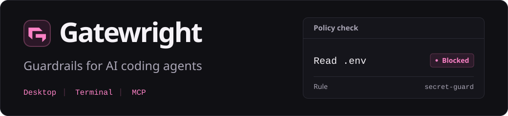
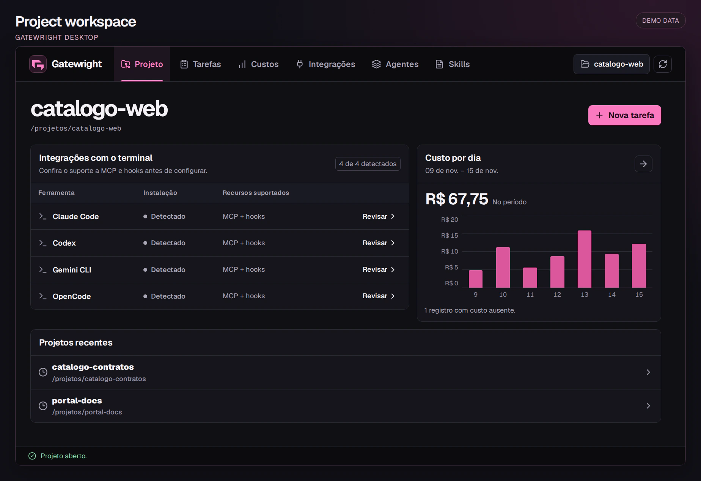
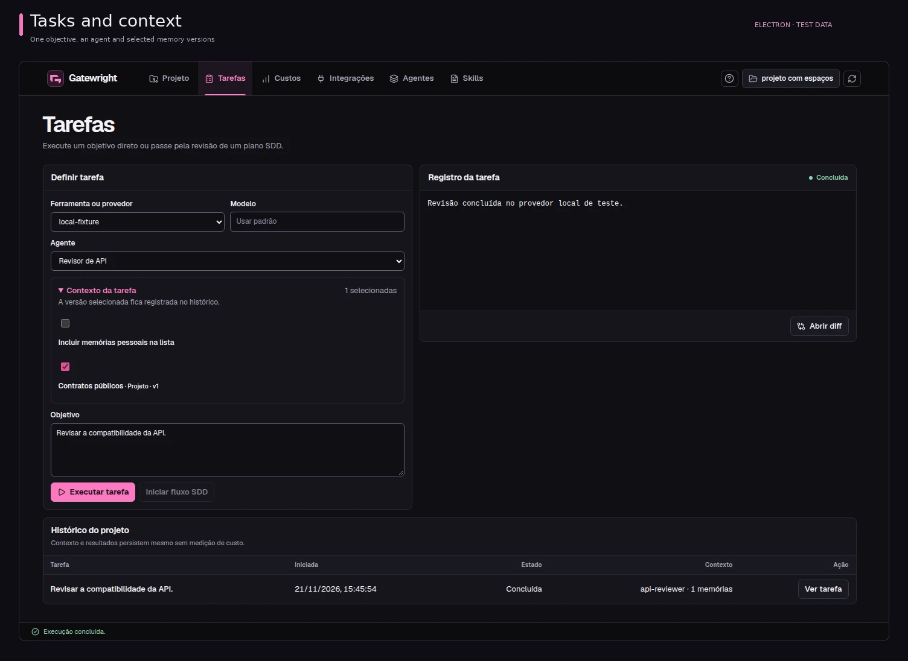
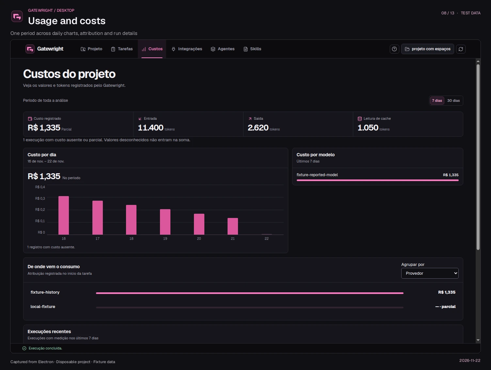
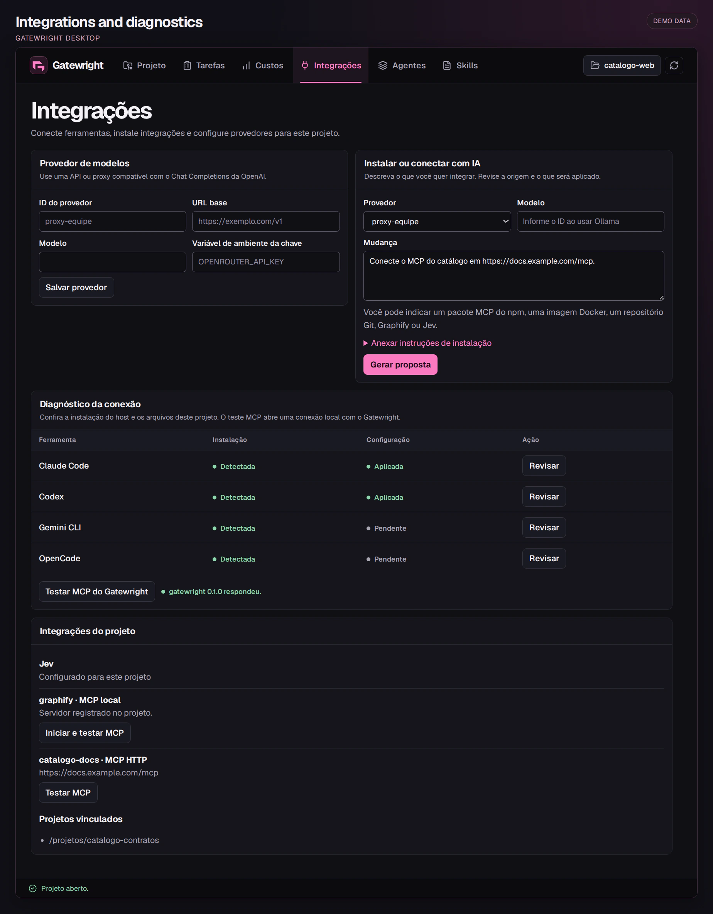
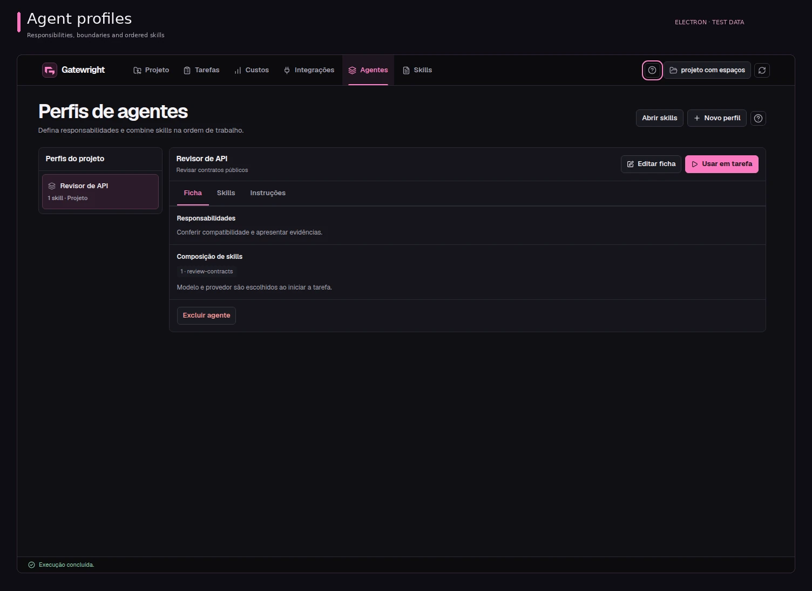
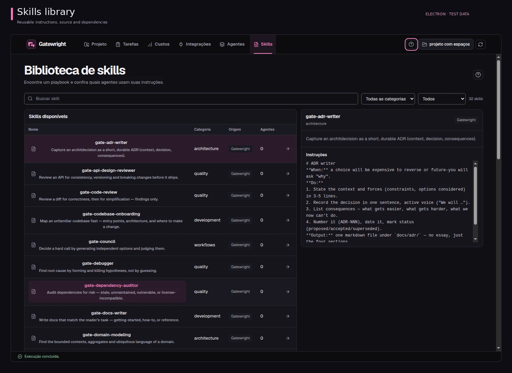
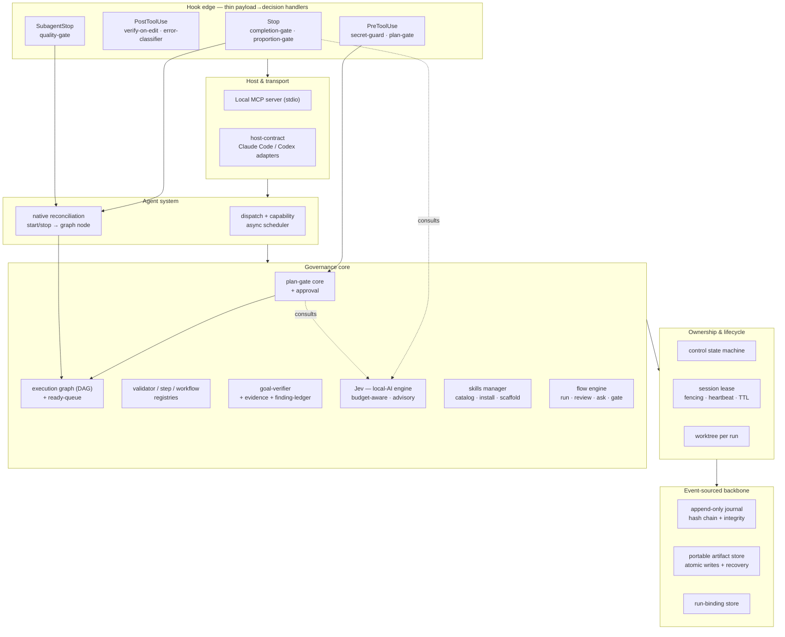
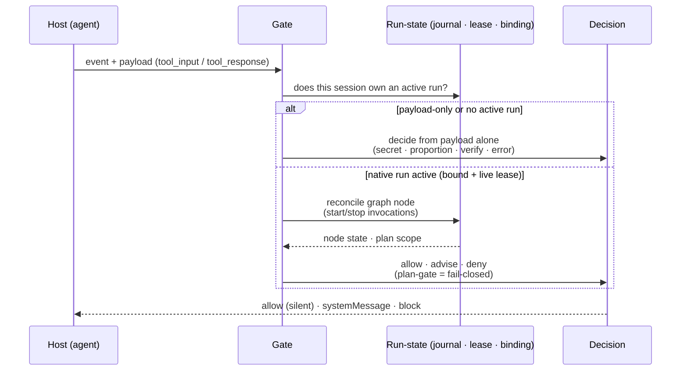

<p align="center">
  
</p>

<p align="center">
  
  
  
  
  
  
</p>

<h1 align="center">Gatewright</h1>

<p align="center">
  <strong>Guardrails that keep AI coding agents inside the lines — versioned in your repo, deterministic, and auditable.</strong>
</p>

<p align="center">
  Gatewright wraps agents like <em>Claude Code</em> and <em>Codex</em> in a set of repo-local <strong>gates</strong> —
  scope control, completion verification, diff proportion, secret protection, handoff quality, budget —
  so an agent stays on task instead of drifting. It ships as a CLI (<code>gate</code>) with an interactive TUI,
  a local <strong>MCP server</strong>, and an <strong>event-sourced core</strong> that makes every decision replayable.
</p>

---

## Desktop and terminal

Gatewright Desktop is an Electron workspace for Linux, macOS, and Windows. Run `npm run desktop:dev` to build and open it. Use Claude Code, Codex, Gemini CLI, or OpenCode through their own binaries. For text completions, set up Ollama or a compatible API or proxy in a project provider profile.

The terminal remains a supported surface. Connect each project's MCP and supported hooks from the desktop, then restart the host. See the [desktop guide and compatibility matrix](docs/DESKTOP.md).

### Desktop screenshots

The six banners show the current interface with a demo project. Connections, run output, and usage figures are sample data.

#### Project

Open a repository, switch between recent projects, and review the MCP and hook configuration for each terminal host. The seven-day chart shows the project's recorded costs at a glance.



#### Tasks

Choose a terminal tool or provider and, optionally, a saved agent. Run a task directly or start a guided SDD flow with a supported terminal host. Follow the log and open the diff when the task finishes.



#### Costs

Compare daily costs over 7 or 30 days and see which models account for the most recorded spend. The recent runs table breaks out input, output, and cached tokens and flags partial or missing cost data.



#### Integrations

Set up a model provider or describe an integration in plain language. Review the proposed steps before applying supported recipes for MCP endpoints, versioned npm packages, local Docker services, Git checkouts, Graphify, or Jev. Use the diagnostics to check host configuration and test MCP connections.



#### Agents

Give an agent a name and objective, then select skills in the order it should follow them. Preview the combined instructions, save the profile, and select it in Tasks or access it through an MCP prompt.



#### Skills

Write a reusable playbook in Markdown and describe when to use it. Gatewright saves it as a project-local `SKILL.md` that you can use in the agent composer or expose as an MCP prompt.




## The problem

Leave a coding agent alone and it drifts. Scope creeps past what you asked for. Diffs balloon.
Verification gets skipped — no typecheck, no tests. Secrets get slurped into context. Token budgets
go unwatched. And every new prompt re-explains the same project conventions from scratch.

The usual fix is a human babysitting the agent, approving each step by hand. That doesn't scale, and
it isn't repeatable — the "rules" live in one person's head.

## The idea

**Turn that discipline into code that lives in your repo.** A gate is a pure
`payload → decision` function: given a lifecycle event (a tool call, a stop, a subagent handoff), it
returns **allow**, **advise**, or **deny** — with no side effects. Because gates are plain, testable
functions versioned alongside the project they protect, the rules are explicit, reviewable, and the
same for every agent and every teammate.

Underneath, an **append-only, hash-chained journal** records every event, so no decision is a black
box: you can audit it, replay it, and recover from a crash deterministically.

Gatewright is an original design, built from the ground up in TypeScript. It is **headless-first** —
no editor coupling, no UI required — just a binary and a server you wire into your agent's hooks. An
interactive TUI sits on top for when you'd rather drive it by hand.

---

## What you get

- 🚦 **Four default hook gates** for secrets, edit checks, shell errors and proportion. Scope, completion and handoff gates exist as core modules.
- 🖥️ **Desktop (Electron + React)** — a local dark-themed workspace for projects, runs, review, usage and configuration. Governs four hosts: Claude Code, Codex, Gemini CLI and **OpenCode** (the latter via a shipped plugin).
- 🧭 **Guided SDD flows** — plan, review, and implement with human approval between steps. The desktop also lets you review the final diff.
- 🧩 **Pluggable modules** — Jev, advisors, savers, models and MCP are swappable `ModuleState`s. Disable a built-in or plug an external one through config — **no compiled adapter**.
- 🧠 **Jev, a local-AI advisor** — optional, budget-aware, local-first judgment for the fuzzy calls a rule can't settle. It *advises*; it never hard-blocks. Jev is one implementation of a pluggable **Advisor** port.
- 🔌 **Local MCP server** — exposes the gate catalog and checks as MCP tools your agent can call.
- 📼 **Event-sourced core** — hash-chained journal, portable artifact store, run-binding, crash recovery, replay. Usage is aggregated into a **daily cost chart** in the desktop.
- 🗂️ **31 curated skills** — reusable SKILL.md playbooks (SDD, code review, debugging, refactors, …) injected into runs.
- 🌳 **Worktree-per-run isolation**, session leases with fencing, and native reconciliation of the agent's own tool calls.

---

## Core principles

| Principle | What it means |
|-----------|---------------|
| **Deterministic & auditable** | Every event is appended to a hash-chained journal. Nothing is a black box — you can replay any run. |
| **Fail-open by default** | Gates never break your agent on a hiccup. Only a deliberate scope/plan rule is allowed to **fail-closed** and block. |
| **Advisory AI, never silent blocking** | The local-AI engine (**Jev**) only *advises* the human gate. It can never hard-block on a non-deterministic hunch. |
| **Human-in-the-loop** | Guided flows stop and show you what the agent produced — the plan, the diff — before you approve the next step. |
| **Composable** | Big gates are assembled from small, reusable atomic validators. |
| **Repo-local** | Config, gates, skills, and history live in your project. Portable, versionable, reviewable. |

---

## The gates

| Gate | Event | What it does |
|------|-------|--------------|
| **secret-guard** | `PreToolUse` | Blocks reading secret files into context (env files, keys, certs). A clean-room static analyzer: it tells reader verbs (`cat`/`grep`) from movers (`cp`/`mv`) and exempts template variants like `.env.example`. |
| **plan-gate** | `PreToolUse` | Blocks in-workspace mutations outside the approved plan's scope. The one gate that **fails closed**. |
| **verify-on-edit** | `PostToolUse` | Flags merge-conflict markers, stray `debugger;`, and missing tests after an edit. Advisory. |
| **error-classifier** | `PostToolUse` | Classifies command failures into actionable remediations (missing module, wrong cwd, …). Never blocks. |
| **proportion-gate** | `Stop` | Over-reach sensor: warns when a turn's diff is disproportionate to the task. |
| **completion-gate** | `Stop` | Enforces run completion via native reconciliation; fails open when off that flow. |
| **quality-gate** | `SubagentStop` | Gates subagent handoffs — native reconciliation, or a handoff-quality heuristic. |

Gates of judgment (proportion / completion / plan) can optionally consult **Jev** and attach an
*Action Card* to their message — advisory input for the human reviewer that never changes the
deterministic decision.

---

## Guided flows

Beyond per-event gating, Gatewright can drive an agent through a whole **spec-driven development
cycle** as one orchestrated flow, with human gates between steps:

```
run (plan)  →  REVIEW  →  gate (sign off?)  →  run (implement)  →  …  →  PR
```

Each step is one of three kinds — a **run** (spawn the agent headless, stream its work live), an
**ask** (the agent emits a `<gate-ask>` block when it needs a human to disambiguate), or a **gate**
(a sign-off you approve or decline). Before any gate or ask, Gatewright shows a **scrollable review
of what the agent just produced** — the plan, its reasoning — so you actually read what you're
approving instead of rubber-stamping it. Decline a gate and the flow stops cleanly.

The live run view is OpenCode-style: a scrollable viewport, tool targets, cleaned markdown, and the
AI's answer rendered in full. You can leave any screen and return to the dashboard at any time.

The desktop runtime records flow inputs (run outputs and your answers) in a per-project journal.
The runtime can replay a flow from that journal. Resuming a recovered review or run from the
desktop window is planned.

---

## Jev — local-AI advisory

**Jev** is an optional judgment layer for the fuzzy cases a deterministic rule can't settle — the
real proportion of a diff, the quality of a handoff, scope disambiguation. It is:

- **Local-first** — talks to Ollama or LM Studio over HTTP. The default Jev endpoint is local. Remote providers and external MCP servers receive the data needed for their calls.
- **Budget-aware** — a per-feature quota caps how much it's consulted.
- **Advisory only** — every verdict is `approve` / `discard` / `abstain`, never a hard block, and all of it is logged to the journal.
- **Zero-install** — Jev installs nothing. Helper scripts detect an already-running local endpoint and write the config Gatewright reads.
- **Swappable** — Jev sits behind an **Advisor** port. Disable it (`set_module_enabled("jev", false)`) and the gate consults no one; or plug an external advisor through config — the gates resolve whichever advisor is active, no code change.

```sh
python3 scripts/jev/detect.py                       # probe Ollama / LM Studio
python3 scripts/jev/configure.py --auto-detect \
        --enabled true --budget proportion-gate=20   # write jev.config.json
```

You can also configure it at runtime through the MCP tool `configure_jev`. Jev defaults to
**disabled** — an unconfigured Jev is a safe no-op. (Timeout defaults to 30s, enough for a local 7B
model to respond rather than always abstaining.)

---

## The TUI

Run `gate dashboard` to open the interactive terminal home screen — no subcommands to memorize.
From the dashboard you can:

| Action | What it does |
|--------|--------------|
| **Flow** | Run an end-to-end SDD → review → PR cycle with human gates. |
| **Run an agent** | Launch an agent through the gate, with skills injected. |
| **Skills** | Browse the gate's curated skill catalog. |
| **Configure this project** | Wire the gates into the project's hooks. |
| **Settings** | Choose gate-wide vs per-project scope. |
| **Install / provision** | Set up Ollama · LiteLLM · a custom endpoint, with a live step log. |
| **Fix pending items** · **Set up dogfood** | Repair config / configure Gatewright to govern its own development. |
| **History** · **Rollback a change** | Review past runs and undo a change. |

Every screen is also a subcommand for scripting (`gate doctor`, `gate history`, `gate skills`, …),
and the read-only ones print plain text so they're headless-friendly.

---

## Install

> Gatewright is in **alpha** and runs from source — there's no published package yet.

**Requirements:** Node ≥ 22.12 and Git. (Jev additionally wants a local LLM endpoint — Ollama or
LM Studio — but installs nothing itself.)

```sh
git clone https://github.com/rfsants001/gatewright.git
cd gatewright
npm ci
```

Build and open the desktop on Linux, macOS, or Windows.

```sh
npm run desktop:dev
```

To open a specific project, run `npm run desktop:dev -- "path/to/project"`. If you already built the project, use `npm run desktop` to launch it directly.

To use the terminal dashboard, run these commands from the checkout.

```sh
npm run build
npm start -- dashboard
```

To expose the `gate` binary on your PATH, run these commands after building.

```sh
npm link         # now `gate` is available globally
gate --version   # gate 0.1.0
gate --help
```

To run the CLI from TypeScript sources, try `npm run dev -- --help`.

### Uninstall

```sh
npm unlink -g gatewright     # remove the global `gate` binary (if you linked it)
rm -rf ~/.gatewright         # remove gate-wide config, sessions and runs
```

Per-project state lives in each repo's `.gatewright/` and `.specs/` — delete those folders to
remove Gatewright from a project. Hooks/MCP it wrote into a host (e.g. `.claude/settings.json`,
`.mcp.json`) can be reverted with `gate rollback` or removed by hand.

### Verify the minimal protected path (no Jev)

Gatewright protects your agent out of the box — **no Jev, no local model, no network required**.
The floor is deterministic: a gate refuses a risky action with a legible reason. For example,
reading a secret file is blocked by `secret-guard`. This path is covered by a smoke test:

```sh
npm test -- src/host/minimal-path.smoke.test.ts
```

It asserts that a `Read` of `.env` is denied with an explained reason, while an ordinary read
(and `.env.example`) passes — the minimum any fresh install must clear before enabling optional
pieces like Jev.

---

## Wire it into your agent

### 1. Hook the gates into lifecycle events

Gatewright reads a hook event as JSON on stdin and replies on stdout. For Claude Code, point each
lifecycle hook at `gate hook` (e.g. in `.claude/settings.json`):

```jsonc
{
  "hooks": {
    "PreToolUse":   [{ "hooks": [{ "type": "command", "command": "gate hook" }] }],
    "PostToolUse":  [{ "hooks": [{ "type": "command", "command": "gate hook" }] }],
    "Stop":         [{ "hooks": [{ "type": "command", "command": "gate hook" }] }],
    "SubagentStop": [{ "hooks": [{ "type": "command", "command": "gate hook" }] }]
  }
}
```

A silent exit means *allow*; a `systemMessage` injects advice; a block decision stops the action.
(The **Configure this project** screen writes this for you.)

### 2. Run the MCP server

Expose the gate catalog and checks as MCP tools (`list_gates`, `check_gate`, `configure_jev`,
`get_jev_config`), skills as **MCP prompts** (`gate.<name>`), and usage/config as **MCP resources**
(`gate://usage`, `gate://config`) over stdio:

```sh
gate serve
```

Register it with your agent (e.g. `.mcp.json`):

```jsonc
{
  "mcpServers": {
    "gatewright": { "command": "gate", "args": ["serve"] }
  }
}
```

#### Manual validation checklist (MCP provider — R1)

> The in-process tests prove the mechanism. Run this checklist once against a real Claude Code
> instance to confirm the full round-trip (NF-004).

- [ ] Add the `gatewright` MCP server entry to `.mcp.json` (or `~/.claude/mcp.json` for global
      access) as shown above, then restart Claude Code.
- [ ] In Claude Code, open the **Prompts** panel (or run `/mcp`) and confirm at least one
      `gate.*` prompt appears in the list (e.g. `gate.gate-code-review`).
- [ ] Select a `gate.*` prompt and invoke it — the skill's markdown body should be injected as
      a user message into the conversation.
- [ ] In Claude Code, open the **Resources** panel and confirm `gate://usage` is listed.
- [ ] Read `gate://usage` — the response should be valid JSON with `totalTokensIn`,
      `byModel`, and `byRun` keys (all zeroes for a fresh project with no runs, populated
      after a run launched through the Gatewright UI).
- [ ] Read `gate://config` — the response should show safe config fields (`defaultEngine`,
      `verbosity`, `jev.enabled`, `jev.model`); endpoint / API key fields must appear as
      `"[REDACTED]"`.
- [ ] Run `gate serve` in a terminal and confirm the four original tools still respond:
      `list_gates`, `check_gate`, `configure_jev`, `get_jev_config`.

### 3. Manage skills

```sh
gate skill list              # list skills in ./skills (or $GATEWRIGHT_SKILLS_DIR)
gate skill new my-skill      # scaffold a SKILL.md + references/ folder
```

### Environment

| Variable | Purpose | Default |
|----------|---------|---------|
| `GATEWRIGHT_SESSIONS_DIR` | Session / run state root | `~/.gatewright/sessions` |
| `GATEWRIGHT_SKILLS_DIR` | Skills catalog root | `./skills` |
| `GATEWRIGHT_JEV_CONFIG` | Jev config file path | `~/.gatewright/jev.config.json` |

---

## Architecture

Gatewright is layered: a thin edge of hooks sits on top of a host/transport layer, an agent system,
a governance core, ownership primitives, and an event-sourced backbone that everything depends on.



### How a gate decides



---

## Project layout

```
src/
  cli/        gate — CLI entrypoint (hook · serve · skill · screens)
  ui/         Ink TUI — dashboard, flow, run-composer, run-live, provision, history, settings
  core/
    journal/        append-only hash-chained event log
    artifact-store/ atomic, crash-safe persistence
    run-binding/    session → run index
    control/        control state machine
    lease/          session lease (fencing · heartbeat · TTL)
    gate/           gate contract + engine + registry
    graph/          execution graph (DAG, ready-queue)
    plan/           plan-gate + scope evaluation
    scope/          module dependency graph + boundaries
    agent/          registry · capability · dispatch scheduler
    reconcile/      native invocation store · reconciler
    jev/            local-AI decision engine (advisory)
    validators/     atomic validators + step/workflow registries
    goal/           finding-ledger · evidence · goal-verifier
    skills/         SKILL.md · catalog · scaffold
    flow/           flow engine + SDD flow + <gate-ask> questions + durable flow-journal
    integrations/   pluggable ModuleState registry + IntegrationSpec
    worktree/       run → git worktree
  gates/      the shipped gates
  host/       host-contract + Claude Code / Codex / Gemini / OpenCode adapters
  desktop/    Electron bridge + launch (runtime assets live in top-level desktop/)
  mcp/        MCP server
desktop/      Electron main + preload + React renderer (dark theme, cost chart)
skills/       31 curated SKILL.md playbooks
scripts/jev/  local-endpoint detection & configuration (Python)
```

---

## Development

```sh
npm run check         # typecheck, build, and run the test suite
npm run typecheck     # typecheck TypeScript without building
npm run build         # build the CLI and desktop renderer
npm test              # build and run Vitest
npm run test:watch    # build once and keep Vitest open
npm run test:desktop  # build and open Electron with a temporary project
```

Run `npm run test:desktop` in a graphical session. On headless Linux, the CI runs it under Xvfb.

TypeScript, ESM, Vitest. The main test suite is hermetic — no external services (Jev is tested with a
deterministic stub and a mocked fetch; git-dependent features use a throwaway repo).

Workflow: spec-driven development (specs under `.specs/`, local to the repo) + GitHub Flow —
one feature per branch off `main`, one PR, human review is the merge gate. Gatewright **dogfoods
itself**: it governs its own development through the same gates it ships.

---

## License

Released under the **MIT License**. Curated skills adapted from third-party sources retain their
original attribution (see `skills/NOTICE.md`).
