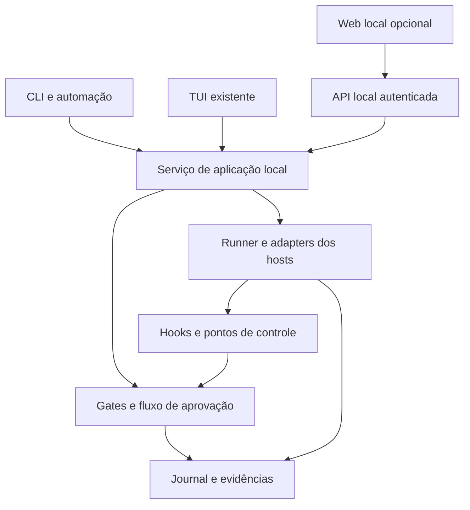

# Gatewright — Parecer sobre o projeto e decisão entre terminal e web

> **Atualização de 13/11/2026.** Gatewright é um orquestrador local multi-host com desktop Linux como interface principal do piloto. A TUI continua disponível durante a transição. O harness Node/TypeScript e MCP stdio funcionam sem a janela. A referência operacional é [Gatewright Desktop](DESKTOP.md).
>
## Decisão posterior

Desktop local é a interface escolhida para o piloto. A TUI continua como transição e o runtime de terminal é parte do produto. A interface web local avaliada no parecer original ficou como alternativa histórica. A decisão agora inclui vários hosts, APIs externas, proxies, Ollama e personalização assistida.

## Histórico de planejamento — 28/10/2026

> Documento de avaliação independente do **GATEWRIGHT-DOSSIE.md**, de 28/10/2026.
> Objetivo: avaliar a proposta, os riscos e o custo-benefício de manter o terminal ou
> desenvolver uma experiência web, com recomendação de arquitetura e prioridades.
> Este parecer analisa o documento fornecido, não o código-fonte. Funcionalidades,
> testes e maturidade descritos no dossiê são declarações do projeto, não resultados
> de uma auditoria realizada nesta análise.

- **Projeto:** Gatewright (`gate`)
- **Data da análise:** 28/10/2026
- **Decisão recomendada agora:** consolidar CLI/headless e manter a TUI existente.
- **Evolução recomendada:** validar um painel web local, inicialmente pequeno.
- **O que não recomendo agora:** substituir a CLI ou iniciar uma plataforma SaaS completa.
- **Confiança:** moderada; faltam código, testes de integração observados e dados de uso externo.

---

## 1. Resumo executivo

**Se a decisão for onde investir o próximo esforço, compensa mais estabilizar o terminal. Se a decisão for qual interface melhor acomoda o produto planejado, a web local tem mais potencial.** São decisões de momentos diferentes.

O Gatewright tem uma ideia forte: transformar regras de trabalho com agentes em políticas explícitas, versionadas e acompanhadas de evidências. Seu valor principal está em controlar e explicar o que o agente pode fazer. A interface serve para tornar esse controle utilizável.

Para scripts, hooks, automação e execução no repositório, a CLI é uma base adequada. Para revisar planos longos, comparar diffs, acompanhar várias execuções e aprovar decisões, o navegador oferece uma superfície mais confortável. Uma interface web pode existir sobre o mesmo motor local, sem transferir a execução para a nuvem.

Minha recomendação é:

1. **Publicar e validar uma versão instalável do núcleo atual.**
2. **Manter a TUI funcional, reduzindo a expansão de telas complexas.**
3. **Experimentar uma web local centrada em revisão e aprovação.**
4. **Considerar colaboração remota somente quando houver demanda comprovada.**

Não recomendo manter duas interfaces completas evoluindo em paralelo sem um benefício demonstrado. Também não considero o investimento já feito na TUI motivo suficiente para insistir nela indefinidamente.

---

## 2. Minha opinião sobre a proposta

### 2.1 O que considero mais forte

| Elemento | Por que tem valor |
|---|---|
| Políticas no repositório | Permitem revisar e compartilhar as regras junto com as mudanças do projeto. |
| Separação entre decisão determinística e conselho de IA | Ajuda a explicar por que uma ação foi permitida ou bloqueada. |
| Aprovação humana com acesso às evidências | Pode reduzir aprovações feitas sem entender o plano ou o diff. |
| Histórico de decisões e artefatos | Facilita investigar falhas e entender a evolução de uma execução. |
| Núcleo independente da interface | Permite mudar a experiência sem reconstruir o mecanismo de governança. |
| Uso no próprio desenvolvimento | Gera retorno rápido, embora não substitua testes com outras pessoas. |

O melhor posicionamento, na minha avaliação, é **governança verificável para agentes de código, integrada ao fluxo do repositório**. Esse foco é mais claro do que tentar ser, simultaneamente, terminal de IA, catálogo de skills, instalador, roteador de modelos e plataforma de observabilidade.

### 2.2 O maior risco é a dispersão

O dossiê reúne muitos produtos potenciais dentro de um alpha: motor de políticas, cockpit, gerenciador de skills, provisioner, consultor local, fluxo SDD, roteamento e futura plataforma de equipe.

Isso amplia os pontos de falha antes de provar que alguém consegue instalar o Gatewright, obter proteção útil e continuar usando. Os aproximadamente 588 testes e 18,6 mil linhas relatados mostram investimento técnico; não demonstram, sozinhos, confiabilidade em ambientes reais nem demanda.

**Eu priorizaria três resultados verificáveis: impedir alterações fora do plano, exigir evidências de conclusão e permitir revisar decisões com clareza.** O restante precisa justificar como melhora esses resultados.

---

## 3. “Web” pode significar coisas bem diferentes

| Opção | Onde o agente executa | Onde a pessoa interage | Consequência principal |
|---|---|---|---|
| CLI/TUI local | Máquina do usuário | Terminal | Aproveita o ambiente atual e favorece automação. |
| Web local | Máquina do usuário, em um processo do Gatewright | Navegador conectado ao serviço local | Melhora a revisão visual mantendo a execução local. |
| Web compartilhada com runners locais | Máquinas ou infraestrutura autorizada | Painel remoto | Acrescenta coordenação, identidades e sincronização. |
| SaaS com execução hospedada | Infraestrutura operada pelo produto | Navegador | Exige provisionar ambientes, isolar execuções e operar o serviço. |

**Uma web local não exige conta, cobrança, hospedagem pública ou upload do código.** Continua exigindo instalação do componente local. Portanto, não elimina automaticamente a dificuldade de onboarding.

Um site comum no navegador, sozinho, também não substitui o processo que executa ferramentas, acessa o repositório e controla subprocessos. Essa função continua precisando de um backend local ou de um ambiente remoto apropriado.

---

## 4. Manter terminal: prós e contras

### Prós

- **Menor mudança imediata:** o dossiê já descreve uma CLI e uma TUI funcionais.
- **Boa integração com o trabalho de desenvolvimento:** comandos podem participar de scripts, hooks e pipelines.
- **Proximidade do ambiente real:** repositório, ferramentas e configurações permanecem onde o desenvolvedor trabalha.
- **Adequado a sessões remotas por SSH:** não exige uma interface gráfica local.
- **Menor carga operacional:** não é necessário manter um serviço hospedado.
- **Execução sem interface:** útil para testes, CI e outras integrações.

### Contras

- **Revisão extensa é mais difícil:** planos, tabelas e diffs disputam espaço e exigem mais navegação.
- **Cockpits complexos aumentam o custo da TUI:** foco, atalhos, rolagem e compatibilidade entre terminais exigem manutenção própria.
- **Visão de várias execuções fica limitada:** comparar evidências lado a lado tende a ser menos confortável.
- **Descoberta de recursos pode ser pior:** menus ajudam, mas nem todo usuário conhece os atalhos e convenções do terminal.
- **Participação de revisores menos técnicos é mais difícil:** a TUI pressupõe familiaridade com esse ambiente.

**Meu parecer:** terminal compensa muito para o motor, automação e primeira distribuição. Não assumiria que será a melhor interface para todo o roadmap de revisão e observabilidade.

---

## 5. Desenvolver web local: prós e contras

### Prós

- **Mais espaço para revisão:** plano, diff, evidências e motivo do bloqueio podem aparecer juntos.
- **Interações mais familiares:** seleção de texto, busca, formulários, links e navegação por mouse.
- **Melhor apresentação de histórico:** filtros, comparações e detalhes sob demanda.
- **Acessibilidade potencialmente melhor:** desde que teclado, foco, contraste e leitores de tela sejam considerados.
- **Aproveitamento do backend:** a arquitetura descrita parece favorecer reutilização do núcleo, se a separação existir também no código.
- **Execução local preservada:** o navegador pode ser apenas uma interface para o processo já responsável pelos agentes.

### Contras

- **Novo software para manter:** frontend, API, autenticação local, reconexão e compatibilidade entre versões.
- **Maior superfície de ataque:** uma interface que pode iniciar comandos precisa proteger as operações locais.
- **Risco de duplicação:** implementar todas as telas na TUI e na web pode consumir o tempo que deveria ir para os gates.
- **Fechar a aba não encerra necessariamente a execução:** o ciclo de vida do processo precisa ser explícito.
- **Estado pode ficar desatualizado:** a interface deve impedir aprovações de um plano ou diff que já mudou.
- **Não resolve sozinho a colaboração:** uma interface em localhost continua sendo, inicialmente, individual.

**Meu parecer:** web local compensa quando a dificuldade de revisar e aprovar se torna um problema recorrente. Eu começaria por essa parte, sem reconstruir todo o cockpit.

---

## 6. E transformar em SaaS?

Há benefícios possíveis: acesso remoto, visão de equipe, permissões por pessoa e histórico compartilhado. Entretanto, esses benefícios vêm acompanhados de responsabilidades que o dossiê ainda não demonstra resolver.

| Benefício pretendido | Trabalho adicional necessário |
|---|---|
| Aprovações por diferentes pessoas | Identidade, autorização, atribuição e revogação de acesso. |
| Vários projetos em um painel | Separação de dados, filtros de acesso e sincronização. |
| Execução hospedada | Ambientes reproduzíveis, isolamento, credenciais e limites de recursos. |
| Histórico central | Retenção, backups, remoção de dados e recuperação operacional. |
| Serviço comercial | Suporte, disponibilidade, faturamento e gestão de incidentes. |

Usar a autenticação já existente do CLI na máquina do usuário não comprova que o mesmo arranjo atende à execução hospedada. Esse cenário exige validar separadamente a integração e as condições de uso do fornecedor.

**Eu não começaria pelo SaaS.** Primeiro provaria que o produto é útil para alguém além do autor e que existe uma necessidade concreta de colaboração. Uma versão auto-hospedada também pode ser avaliada nessa etapa, mas não elimina manutenção e segurança.

---

## 7. Comparação de custo-benefício

Avaliação qualitativa para o estágio alpha descrito; não representa benchmark nem orçamento.

| Critério | CLI/TUI atual | CLI + web local | SaaS com execução hospedada |
|---|---|---|---|
| Esforço adicional imediato | Menor | Médio | Muito maior |
| Automação e uso headless | Muito favorável | Muito favorável, preservando a CLI | Depende dos runners e das APIs |
| Revisão de planos e diffs | Possível, com limitações de espaço | Muito favorável | Muito favorável |
| Compatibilidade com ambiente local | Direta, sujeita aos hosts suportados | Mantida pelo backend local | Precisa ser reconstruída ou reproduzida |
| Instalação pelo usuário | Necessária | Necessária para o backend | Pode ser reduzida, com maior setup remoto |
| Colaboração entre pessoas | Limitada | Limitada no MVP | Favorável, após implementação |
| Operação de infraestrutura | Baixa | Baixa, sem hospedagem pública | Alta |
| Risco de dispersão neste alpha | Já existe na TUI rica | Controlável com escopo pequeno | Alto |
| Recomendação atual | Consolidar | Validar depois | Adiar |

Não há dados suficientes para estimar prazos em semanas, custo financeiro ou retorno comercial. Qualquer número exato neste momento seria uma suposição.

---

## 8. Pontos técnicos que eu revisaria antes de expandir

### 8.1 MCP configurado não comprova interceptação universal

A seção 6.5 afirma que toda chamada de ferramenta passa pelo MCP do Gatewright. A documentação oficial descreve `--strict-mcp-config` como uma restrição aos servidores MCP carregados; isso não demonstra que ferramentas nativas sejam automaticamente redirecionadas ao servidor. Hooks `PreToolUse` possuem um mecanismo próprio de decisão. [1][2]

**Consequência para o projeto:** apresentar testes de ponta a ponta que mostrem cada caminho controlado — ferramenta nativa, ferramenta MCP, shell e subagente. Oferecer `check_gate` como ferramenta consultável é diferente de garantir que nenhuma ação relevante ocorra sem avaliação.

Essa é uma lacuna de evidência no dossiê, não uma conclusão de que a implementação esteja incorreta.

### 8.2 Bloqueio deliberado e falha interna são coisas diferentes

O texto diz que `secret-guard` bloqueia segredos, mas que somente `plan-gate` é fail-closed. Isso pode ser coerente: um gate pode bloquear quando identifica um segredo e liberar quando sofre erro interno. O problema é que o efeito dessa escolha não está suficientemente explícito.

Eu definiria, por gate, o comportamento diante de violação detectada, timeout, payload inválido e falha do serviço. Para operações sensíveis, avaliaria interromper ou exigir revisão quando a checagem não puder ocorrer. Para conselhos de estilo e proporção, continuar com aviso pode ser adequado.

### 8.3 Journal encadeado não é inviolável por definição

Uma cadeia de hashes ajuda a detectar alterações em relação a uma referência confiável. Se alguém puder reescrever todo o histórico e recalcular os hashes, a cadeia local sozinha não prova autenticidade.

Para auditoria mais forte, eu avaliaria referências externas confiáveis, assinaturas ou armazenamento protegido conforme o modelo de ameaça. Também separaria **reconstruir o estado a partir dos eventos** de **reexecutar o agente e obter exatamente a mesma resposta**. O segundo resultado não decorre do primeiro.

### 8.4 Worktree separa arquivos; não estabelece uma sandbox

Worktrees ajudam a evitar conflito entre mudanças. Não demonstram isolamento de rede, processos ou credenciais. A expressão “isolamento” deve dizer exatamente o que está separado e o que continua compartilhado.

### 8.5 Local-first precisa ter fronteiras explícitas

O Jev local não torna toda a cadeia local. O agente principal e ferramentas externas podem usar serviços remotos. Da mesma forma, o journal pode registrar conteúdo sensível recebido nos eventos.

Eu documentaria quais dados são persistidos, quais podem sair da máquina e o que é removido antes do registro. Configurações e políticas podem ser versionadas no Git; transcripts, credenciais e histórico operacional não deveriam ser incluídos automaticamente.

### 8.6 Maturidade e suporte precisam de evidências mais precisas

O dossiê menciona Claude Code e Codex, mas o layout detalha principalmente o adapter Claude. Eu publicaria uma matriz por host: detecção, execução, hooks, bloqueio, cancelamento e testes de integração.

Também esclareceria o que “marketplace entregue” significa na F6 diante do catálogo local descrito, e o que sustenta a expressão “verificação formal”. Testar transições de estado é útil; chamar isso de prova formal exige evidência adicional.

A alegação de que não existe solução concorrente deve ser tratada como hipótese: este parecer não fez um levantamento exaustivo de mercado.

---

## 9. Arquitetura que recomendo

**Um único motor de governança, com interfaces que consomem o mesmo contrato.** A aprovação precisa ser validada no backend; não pode depender apenas de um botão desabilitado na tela.

O diagrama é uma proposta de separação de responsabilidades, não uma descrição verificada do código atual.

Requisitos que eu adotaria:

- **Identidade e versão da aprovação:** associar a decisão ao run, plano, diff e versão das políticas examinados; invalidá-la se o objeto aprovado mudar.
- **Comandos idempotentes:** uma repetição causada por reconexão não deve iniciar o mesmo run duas vezes.
- **Processo independente da aba:** indicar claramente se fechar a interface mantém o trabalho ativo e como interrompê-lo.
- **Eventos recuperáveis:** reconectar usando posição no histórico, sem perder nem duplicar decisões.
- **Proteção do serviço local:** limitar a escuta ao loopback por padrão, autenticar operações e validar origem/host. A documentação do SDK MCP destaca validação de `Origin` e `Host` contra ataques ao servidor local. [3]
- **Renderização segura:** tratar Markdown, logs e conteúdo gerado pelo agente como entrada não confiável.
- **Um só lugar para as regras:** nenhuma política exclusiva da TUI ou do frontend web.

Os conceitos e modelos React existentes podem ajudar, mas componentes Ink não devem ser presumidos reutilizáveis diretamente no navegador.

---

## 10. Escopo mínimo para testar a web

Eu faria uma interface com apenas três áreas:

| Área | Conteúdo mínimo | Hipótese a validar |
|---|---|---|
| Execuções | Status, projeto, duração e pendências | Encontrar o que exige atenção fica mais fácil. |
| Detalhe de execução | Plano, diff, eventos relevantes e verificações | O usuário entende melhor o que ocorreu. |
| Aprovação | Evidência revisada, motivo, aprovar ou recusar | A decisão fica mais rápida sem perder qualidade. |

Começaria com visualização somente leitura. Depois acrescentaria aprovação vinculada à versão e cancelamento, com testes de estado e concorrência.

**Fora desse primeiro experimento:** marketplace, cadastro de equipes, billing, editor completo, roteador de modelos e cópia de todas as configurações da TUI.

O terminal continua sendo o ponto de entrada. Um futuro comando para abrir o painel pode ser acrescentado, mas este parecer não presume que já exista. O `gate serve` atual é descrito como servidor MCP; não deve ser confundido com um servidor HTTP de interface.

---

## 11. Ordem de execução sugerida

### Etapa 1 — Tornar a versão atual utilizável por terceiros

Concluir licença pretendida, versionamento, pacote, CI, instruções de instalação e desinstalação. Validar o caminho mínimo sem Jev e sem dependências opcionais.

**Critério de saída:** alguém que não participou do desenvolvimento consegue instalar, executar uma tarefa protegida e entender uma recusa sem intervenção do autor.

### Etapa 2 — Demonstrar a governança

Testar integração real com os hosts declarados, falha de hook, timeout, cancelamento, retomada e tentativa de ação fora do plano. Mostrar quais caminhos são protegidos e quais não são.

**Critério de saída:** a promessa de controle corresponde a comportamentos reproduzíveis e limitações documentadas.

### Etapa 3 — Validar o painel web local

Implementar o escopo mínimo e comparar com a TUI usando as mesmas tarefas de revisão. Alternar a ordem das interfaces para reduzir o efeito de aprendizagem.

**Critério de saída:** melhoria observada na leitura e nas decisões que justifique o custo adicional de manutenção.

### Etapa 4 — Decidir a interface principal e a colaboração

Se a web for claramente preferida para revisar, torná-la a experiência principal desse fluxo. Manter CLI como contrato e TUI como interface compacta. Se o ganho não aparecer, interromper a expansão web.

Só depois avaliar equipe, acesso remoto, auto-hospedagem ou SaaS.

---

## 12. Como medir se realmente compensa

Um piloto com 5 a 10 pessoas externas ao projeto pode revelar dificuldades importantes; não representa validação estatística de mercado. O número é uma sugestão de experimento.

| Pergunta | Evidência útil |
|---|---|
| A instalação é simples? | Tempo até a primeira execução protegida e pontos de abandono. |
| Os gates ajudam? | Violações conhecidas impedidas, violações que passaram e bloqueios indevidos. |
| A web melhora a revisão? | Tempo de revisão e quantidade de problemas identificados nas mesmas tarefas. |
| As aprovações têm qualidade? | Aprovações equivocadas de planos ou diffs com problemas preparados para o teste. |
| O controle atrapalha demais? | Latência por gate e espera adicional por execução, separando consultas ao Jev. |
| Existe utilidade recorrente? | Uso em novos projetos e retorno após algumas semanas. |
| A manutenção é sustentável? | Defeitos e esforço específicos de cada interface. |

O objetivo não é simplesmente aumentar o número de aprovações ou torná-las mais rápidas. É permitir decisões melhores com menos esforço.

---

## 13. Posicionamento e sustentação

Eu manteria público e bem documentado o núcleo de políticas, adapters e formato das evidências. Como hipótese futura de sustentação, avaliaria suporte, implantação assistida ou serviços de colaboração.

Uma camada paga só faz sentido se resolver necessidades pelas quais equipes estejam dispostas a pagar. “Governança empresarial” não é uma demanda comprovada apenas porque o produto tem logs e aprovações.

A diferenciação mais defensável seria uma combinação de **portabilidade comprovada entre hosts, explicações claras e controle reproduzível**. Quantidade de telas, skills ou estruturas de dados é uma característica de implementação, não um benefício suficiente por si só.

---

## 14. Parecer final

**Eu continuaria o projeto, mas reduziria a amplitude do roadmap.** A proposta de governança é promissora; o principal risco é construir muitas camadas antes de comprovar que o núcleo funciona de forma confiável para outras pessoas.

**Hoje, compensa mais consolidar o terminal. Para o produto de revisão e observabilidade descrito, eu apostaria em web local como próxima experiência a validar.** Não substituiria a CLI e não levaria a execução para a nuvem apenas para obter uma interface melhor.

A decisão recomendada é: **núcleo headless permanente; CLI estável; TUI mantida com escopo controlado; web local experimental; SaaS condicionado à demanda.**

Essa recomendação muda se o objetivo se limitar ao uso pessoal via terminal — nesse caso, a web pode nunca compensar. Se o objetivo principal passar a ser revisão por várias pessoas e acesso remoto, a camada compartilhada ganha prioridade, acompanhada de requisitos de identidade e autorização.

---

## 15. Fontes e limites da avaliação

- **Fonte principal:** `GATEWRIGHT-DOSSIE.md`, fornecido pelo usuário, datado de 28/10/2026.
- **[1] Claude Code — CLI reference:** [documentação oficial](https://code.claude.com/docs/en/cli-reference). Usada para conferir o papel de `--strict-mcp-config`.
- **[2] Claude Code — Hooks reference:** [documentação oficial](https://code.claude.com/docs/en/hooks). Usada para conferir a distinção entre ferramentas MCP e decisão por hooks.
- **[3] MCP TypeScript SDK — Origin validation:** [documentação oficial](https://ts.sdk.modelcontextprotocol.io/v2/api/@modelcontextprotocol/fastify/middleware/originValidation.html). Usada para fundamentar cuidados com serviços locais acessados por navegador.

Fontes externas consultadas em 28/10/2026. A recomendação de produto é julgamento desta análise, não conclusão das fontes. Não houve inspeção do repositório, execução da suíte, avaliação de usuários, orçamento de implementação ou estudo exaustivo de concorrência.
