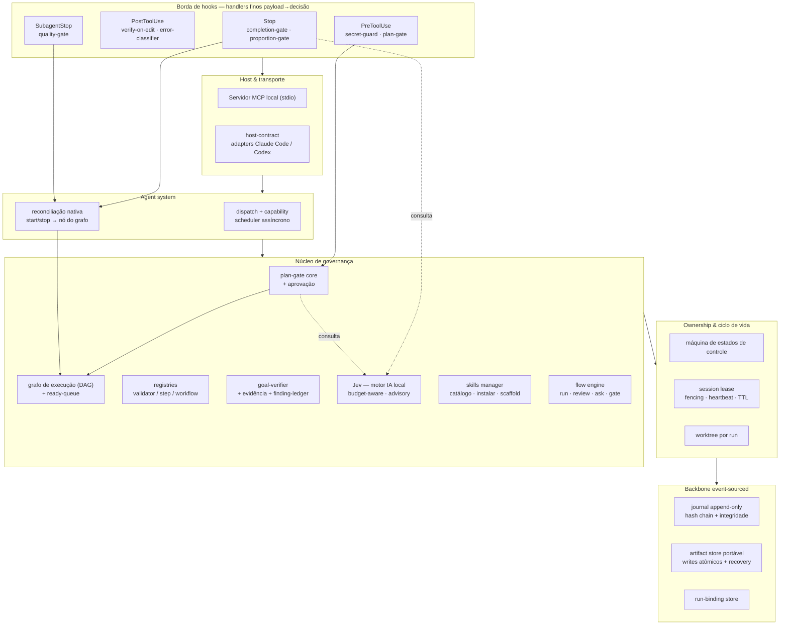
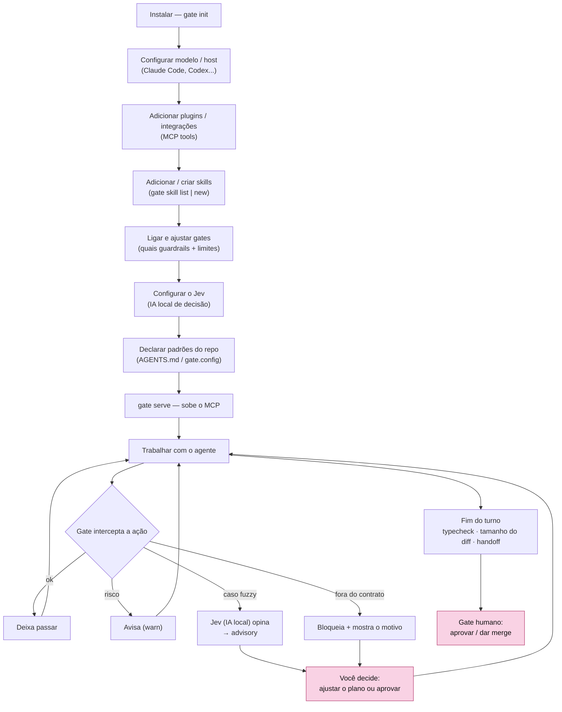
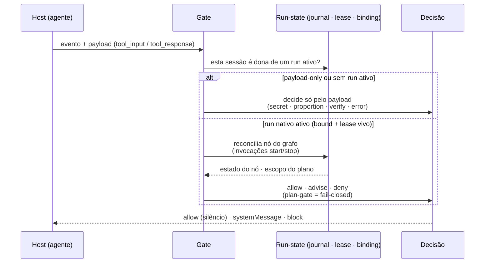
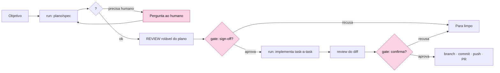

# Gatewright — Dossiê completo do projeto

> **Atualização de 13/11/2026.** Gatewright é um orquestrador local multi-host com desktop Linux como interface principal do piloto. A TUI continua disponível durante a transição. O harness Node/TypeScript e MCP stdio funcionam sem a janela. A referência operacional é [Gatewright Desktop](DESKTOP.md).
>
## Estado atual do produto

O desktop GTK adiciona projeto, execução e Flow SDD, revisão, consumo e configuração por IA. A arquitetura e as telas TUI descritas no histórico abaixo correspondem às fases anteriores. Sete gates existem como módulos. Quatro estão no registro padrão. R0 e R0.5 foram integradas. A R1 está nesta linha de trabalho, com prompts e resources no servidor e validação de clientes reais em aberto. O diretório .specs continua local.


## Histórico de planejamento — 28/10/2026

> Documento de avaliação. Objetivo: dar a uma IA avaliadora **tudo** sobre o Gatewright
> — problema, ideia, objetivos, funcionalidades, arquitetura, mapeamento, fluxogramas,
> estado atual e roadmap — para decidir se o projeto deve **permanecer CLI** ou **virar
> algo maior** (TUI/produto/plataforma). É autocontido: não exige acesso ao código.

- **Nome de trabalho:** Gatewright (binário/CLI: `gate`)
- **Status:** Alpha, roda a partir do código-fonte (sem pacote publicado ainda)
- **Licença pretendida:** MIT (open-source)
- **Stack:** TypeScript / Node ≥ 22, ESM strict, `@modelcontextprotocol/sdk`, Ink (React no terminal), Vitest
- **Tamanho atual:** ~275 arquivos de código, ~18.6k linhas, ~588 casos de teste (91 arquivos de teste), 7 gates, 31 skills curadas
- **Criado em:** 2026-10-14 · **Este dossiê:** 2026-10-28

---

## 1. Resumo executivo (TL;DR)

Gatewright é uma **camada de governança (guardrails) headless e open-source para agentes
de IA de código** — como Claude Code e Codex. Ele resolve um problema concreto: deixado
sozinho, um agente de código **derrapa** (escopo cresce, diffs incham, verificação é
pulada, segredos vazam pro contexto, orçamento de token estoura, e as convenções do projeto
são re-explicadas a cada prompt).

A solução transforma **a disciplina de um humano revisor em código versionado no repo**. O
núcleo é um motor de **gates**: funções puras `payload → decisão` que, dado um evento do
ciclo de vida do agente (uma chamada de ferramenta, um `Stop`, um handoff de subagente),
retornam **allow / advise / deny** — sem efeitos colaterais. Por serem funções puras,
testáveis e versionadas junto do projeto que protegem, as regras ficam **explícitas,
revisáveis e idênticas** para todo agente e todo membro do time.

Por baixo, um **journal append-only hash-encadeado** registra cada evento — nenhuma decisão
é caixa-preta: pode ser auditada, re-executada (replay) e recuperada de um crash de forma
determinística.

Hoje o Gatewright já é **muito mais que um linter de agente**: ele **dirige** o agente como
subprocesso headless controlado (o gate *É* o cockpit), tem uma **TUI estilo OpenCode**
(transcript renderizado, reasoning, tokens por turno), um **advisor de IA local** (Jev), um
**catálogo de 31 skills**, um **provisioner** que instala dependências sozinho, e um motor
de **fluxo SDD ponta-a-ponta** (objetivo → spec → review humano → implementação → PR).

---

## 2. O problema

Agentes de código autônomos têm um padrão de falha previsível:

| Falha | Sintoma |
|---|---|
| **Scope creep** | O agente faz muito além do que foi pedido; toca arquivos fora do combinado. |
| **Diff balloon** | Mudanças desproporcionais ao tamanho da tarefa. |
| **Verificação pulada** | Finaliza sem rodar typecheck/test/build. |
| **Vazamento de segredo** | Lê `.env`, chaves, certificados pro contexto do modelo. |
| **Budget cego** | Nenhum controle de consumo de token/custo; a fatura surpreende. |
| **Handoff vazio** | Subagente devolve "done" sem evidência verificável. |
| **Re-explicação** | As convenções do projeto (branch protegida, Conventional Commits, idioma das docs, fluxo de ticket) são repetidas em todo prompt. |

**O remédio usual** é um humano *babysitting* o agente, aprovando cada passo na mão. Isso
**não escala** e **não é repetível** — as "regras" vivem na cabeça de uma pessoa.

**Lacuna de mercado:** não existe uma camada **open-source, headless e plugável** que
governe o agente de forma **versionada no próprio repo**. (A ideia nasceu de engenharia
reversa comportamental — clean-room — do HubStack, uma extensão de VSCode fechada; o
Gatewright extrai o *conceito/arquitetura*, nunca código ou marca de terceiros.)

---

## 3. A ideia (proposta de valor)

**Transformar a disciplina do revisor em código que vive no repositório.**

Um gate é uma função pura `payload → decisão`: dado um evento de ciclo de vida, devolve
**allow**, **advise** ou **deny** — sem efeitos colaterais. Porque são funções simples,
testáveis e versionadas ao lado do projeto que protegem, as regras ficam explícitas,
revisáveis e iguais para todo agente e todo colega de time.

Por baixo, o **journal append-only hash-encadeado** registra cada evento — nenhuma decisão
é caixa-preta: dá pra auditar, replay e recuperar de crash deterministicamente.

É **headless-first**: sem acoplamento a editor, sem UI obrigatória — só um binário e um
servidor que você pluga nos hooks do agente. Uma TUI interativa fica *por cima*, pra quando
você preferir dirigir na mão.

### Princípios de design

| Princípio | O que significa |
|---|---|
| **Determinístico & auditável** | Todo evento vai pro journal hash-encadeado. Nada é caixa-preta; qualquer run é replayável. |
| **Fail-open por padrão** | Gates nunca quebram o agente por um soluço. Só uma regra deliberada de escopo/plano pode **fail-closed** e bloquear. |
| **IA advisory, nunca bloqueio silencioso** | O motor de IA local (**Jev**) só *opina* pro gate humano. Nunca hard-block num palpite não-determinístico. |
| **Human-in-the-loop** | Fluxos guiados param e mostram o que o agente produziu (o plano, o diff) antes de você aprovar o próximo passo. |
| **Composável** | Gates grandes são montados de validadores atômicos pequenos e reutilizáveis. |
| **Repo-local** | Config, gates, skills e histórico vivem no projeto. Portável, versionável, revisável. |

---

## 4. Objetivos

1. Motor de **gates plugáveis** (plan, completion, proportion, secret, quality, …) como funções payload→decisão.
2. **Backbone event-sourced** (journal hash-encadeado + artifact store + recovery) como fundação de toda a governança.
3. **Servidor MCP local** + abstração de host (Claude Code / Codex) headless.
4. **Padrões-como-código** lidos do repo (`AGENTS.md`/`CLAUDE.md` + `gate.config`); se um padrão não existe, o agente **pergunta, não chuta**.
5. **Skills manager** — catálogo + instalar + criar skill.
6. **Jev** — motor de decisão com IA local, **advisory** pro gate humano, pros casos fuzzy.

### Não-objetivos (declarados)
- Acoplar a um editor específico (VSCode/Electron) — Gatewright é headless-first.
- Jev como decisor autônomo — Jev é **sempre advisory**, nunca bloqueio não-determinístico.
- (Histórico) UI era não-objetivo da v1; foi reconsiderado e hoje há TUI de primeira classe.

---

## 5. Público-alvo

- **Devs e times** que trabalham com agentes de código e querem guardrails/governança **versionados**.
- Projeto **open-source** (objetivo declarado: disponibilizar livre).
- **Uso pessoal do autor (Rafael):** formaliza o "modo-tutor"/SDD (gates, GitHub Flow,
  `/sdd-phase`, `/sdd-review`) como produto reutilizável. Meta-bônus: *dogfooding* — o
  Gatewright governa o próprio desenvolvimento pelos gates que ele mesmo entrega.

---

## 6. Funcionalidades

### 6.1 Os 7 gates entregues

| Gate | Evento | O que faz |
|---|---|---|
| **secret-guard** | `PreToolUse` | Bloqueia leitura de segredos pro contexto (env, chaves, certs). Analisador estático clean-room: distingue verbos de leitura (`cat`/`grep`) de movimentação (`cp`/`mv`) e isenta variantes template (`.env.example`). |
| **plan-gate** | `PreToolUse` | Bloqueia mutações no workspace fora do escopo do plano aprovado. O único gate que **fail-closed**. |
| **verify-on-edit** | `PostToolUse` | Sinaliza marcadores de conflito de merge, `debugger;` perdido e testes faltando após um edit. Advisory. |
| **error-classifier** | `PostToolUse` | Classifica falhas de comando em remediações acionáveis (módulo faltando, cwd errado…). Nunca bloqueia. |
| **proportion-gate** | `Stop` | Sensor de over-reach: avisa quando o diff do turno é desproporcional à tarefa. |
| **completion-gate** | `Stop` | Força conclusão do run via reconciliação nativa; fail-open fora desse fluxo. |
| **quality-gate** | `SubagentStop` | Gateia handoffs de subagente — reconciliação nativa ou heurística de qualidade de handoff. |

Gates de julgamento (proportion / completion / plan) podem opcionalmente consultar o **Jev**
e anexar um **Action Card** à mensagem — input advisory pro revisor humano que **nunca** muda
a decisão determinística.

### 6.2 Fluxos guiados (Flow engine — SDD ponta-a-ponta)

Além do gating por-evento, o Gatewright dirige o agente por um **ciclo de desenvolvimento
spec-driven** inteiro, com gates humanos entre etapas:

```
run (plan) → REVIEW → gate (sign off?) → run (implement) → … → PR
```

Cada etapa é de um de três tipos:
- **run** — spawna o agente headless e faz streaming do trabalho ao vivo;
- **ask** — o agente emite um bloco `<gate-ask>{questions:[…]}</gate-ask>` quando precisa de um humano pra desambiguar; o gate parseia e renderiza a UI certa (texto / confirmar / seleção / multiselect);
- **gate** — um sign-off que você aprova ou recusa.

Antes de qualquer gate ou ask, o Gatewright mostra uma **revisão rolável do que o agente
acabou de produzir** (o plano, o raciocínio) — pra você *ler* o que está aprovando em vez de
carimbar. Recuse um gate e o fluxo para limpo.

> **A sacada:** `claude -p` é one-shot (não pergunta no meio). Então a interação vive em
> **checkpoints entre etapas** via protocolo `<gate-ask>`.

### 6.3 Jev — advisory de IA local

Camada de julgamento opcional pros casos fuzzy que uma regra determinística não resolve (a
proporção real de um diff, a qualidade de um handoff, desambiguação de escopo):

- **Local-first** — fala com Ollama ou LM Studio via HTTP. Nada sai da máquina.
- **Budget-aware** — quota por feature limita quanto é consultado.
- **Advisory only** — todo veredito é `approve` / `discard` / `abstain`, nunca hard-block; tudo logado no journal.
- **Zero-install** — scripts helper detectam um endpoint local já rodando e escrevem a config que o gate lê.
- **Aprende com correções** — CorrectionLedger calibra confiança por feature (nunca vira block).

Defaults: **desabilitado** (um Jev não-configurado é no-op seguro); timeout 30s.

### 6.4 Servidor MCP local

Expõe o catálogo de gates e as checagens como **MCP tools** (`list_gates`, `check_gate`,
`configure_jev`, `get_jev_config`) sobre stdio — o agente chama o gate como ferramenta.

### 6.5 Engine Runner — "o gate É o cockpit"

**Virada de arquitetura (2026-10-17):** em vez de *lançar* a IA pra fora (handoff cru que
não passa pelo MCP → não usa Jev/gates), o gate **dirige a engine como subprocesso headless
controlado por ele**. Escrevo o prompt dentro do gate, escolho a engine, anexo contexto,
clico Run. Como o gate dirige a engine e injeta **seu próprio MCP** (`--strict-mcp-config`) e seus hooks, **gates + Jev disparam de verdade** na sessão. (Precisão: o *enforcement* por evento vem dos **hooks** do host — `PreToolUse`/`PostToolUse`/`Stop`/`SubagentStop` —, que o host chama em toda tool-call; o MCP é a superfície de *consumo*. Não é o MCP que redireciona ferramentas nativas.)

- Mecanismo: `claude -p "<prompt>" --mcp-config .gatewright/gate.mcp.json --strict-mcp-config --append-system-prompt "<skills>" --output-format stream-json`.
- **Assinatura herdada** do `claude` já logado (sem API key).
- Cada evento do stream → **persistido no journal** (replay/auditoria).
- Controle de run: cancelar/parar (SIGTERM→SIGKILL), estados refletidos na TUI.

### 6.6 TUI (Ink) — cockpit estilo OpenCode

`gate` sem argumentos abre uma home interativa (sem subcomandos pra decorar). O arco
**29→30→31** entregou um cockpit coerente OpenCode-style:

- **Modelo Parts/Turns** — cada evento vira `TextPart | ToolPart | ReasoningPart`; turns com tokens/custo.
- **Agrupamento** — grupos `exploration` / `reasoning` / `activity` colapsáveis; verbosidade `low/medium/high` (tecla `v`).
- **Markdown renderizado** (não stripped) — code blocks com highlight, tabelas, listas.
- **Reasoning como cidadão de primeira classe** — bloco colapsável com timer e sumário.
- **Tokens por turno** — `↑1.2k ↓847 cache 78% ~R$0.12`.
- **RunScreen integrado** — split-pane (transcript + composer + sidebar), session tabs, command palette (`ctrl+p`), dialogs, foco por `Tab`, virtual scroll com `rowWeight`.
- **Design system compartilhado** — `theme`, `AppFrame`, `Badge`, `TabBar`, `ScrollableList`, `SplitView`, `useTerminalSize` — propagado a todas as telas (dashboard, history, skills, settings, provision, flow).

Menu do dashboard: **Flow · Run · Skills · Configure · Settings · Install/provision · Fix · Dogfood · History · Rollback · Launch raw (escape hatch).**

Toda tela também é subcomando pra scripting (`gate doctor`, `gate history`, `gate skills`…),
e as read-only imprimem texto puro (headless-friendly).

### 6.7 Skills manager (31 skills curadas)

Catálogo de SKILL.md reutilizáveis (clean-room, conteúdo próprio), injetadas no run via
`--append-system-prompt`. `gate skill list` / `gate skill new <nome>` (scaffold).

Exemplos do catálogo atual: `gate-spec-driven`, `gate-sdd-{init,phase,execute,review,state}`,
`gate-code-review`, `gate-security-review`, `gate-debugger`, `gate-refactor`,
`gate-test-generator`, `gate-pr-author`, `gate-flow`, `gate-human-gate`,
`gate-architecture`/`gate-domain-modeling`, `gate-migration-architect`,
`gate-observability-designer`, `gate-dependency-auditor`, `gate-adr-writer`,
`gate-rfc-writer`, `gate-mermaid`, `gate-package-installer`, `gate-council`, etc.

### 6.8 Onboarding / self-config / provisioner

- **`gate doctor`** — painel read-only ✓/⚠/✗ com "como resolver"; detecta Claude Code, Ollama + modelos, Codex, LM Studio.
- **`gate init`** — wizard que escreve as configs sozinho (merge seguro em settings do Claude Code · `.mcp.json` · `jev.config.json`), faz scaffold de `.specs`/`.gatewright` e registra o projeto no registro global.
- **`gate history` / `rollback` / `fix`** — revisões before/after revertíveis; rollback auditável e re-revertível; fix seletivo.
- **Provisioner** — o gate instala sozinho Ollama (+`ollama pull`), LiteLLM, graphify e pacotes custom; executor injetável; grava no config do escopo; tela Install com log de steps.
- **Config em 2 níveis** — escopo gate (`~/.gatewright/config.json`) vs projeto (`<cwd>/.gatewright/config.json`) com `resolve()`.
- **Dogfood** — self-service: liga hooks+MCP, verifica e diz "pronto".
- **Recomendador de modelos** (estilo canirun.ai) — detecta hardware (RAM/CPU/GPU best-effort) e ranqueia modelos Ollama por fit.

### 6.9 Event-sourced core + isolamento

- **Journal append-only hash-encadeado** + verificação de integridade / detecção de adulteração.
- **Portable artifact store** com write atômico (tmp+rename) e recuperação de crash.
- **Run-binding store** (`[cwd][sessionKey] → runSlug`).
- **Máquina de estados de controle** (IDLE→RUNNING→PASSED/FAILED/CANCELLED) com verificação formal de transições.
- **Session-lease** com fencing token, reclaim de lock stale, heartbeat e TTL.
- **Worktree por run** — isolamento em git worktree.
- **Replay / time-travel** de runs a partir do journal.

---

## 7. Arquitetura

Gatewright é **em camadas**: uma borda fina de hooks sobre host/transporte, um agent system,
um núcleo de governança, primitivas de ownership, e um backbone event-sourced que tudo
depende.



### Estrutura de aplicação de DS&A (diferencial técnico)
O projeto aplica estrutura de dados/algoritmos **de propósito**: hash chain (journal), FSM
(controle), DAG + ready-queue + ordenação topológica (grafo de execução), grafo de
dependências de módulos + alcançabilidade + detecção de violação de fronteira (plan-gate),
locks com fencing (lease), virtual scrolling por peso (`rowWeight`).

---

## 8. Mapeamento de módulos (layout do código)

```
src/
  cli/        gate — entrypoint CLI (hook · serve · skill · telas)
  ui/         TUI Ink — dashboard, flow, run-composer, run-live/run-screen, provision, history, settings
    run/      cockpit OpenCode: colors, markdown, reasoning, tool-part, header, context-bar, viewport, keymap…
  core/
    journal/        log de eventos append-only hash-encadeado
    artifact-store/ persistência atômica, crash-safe
    run-binding/    índice sessão → run
    control/        máquina de estados de controle
    lease/          session lease (fencing · heartbeat · TTL)
    gate/           contrato de gate + engine + registry
    graph/          grafo de execução (DAG, ready-queue)
    plan/           plan-gate + avaliação de escopo
    scope/          grafo de dependência de módulos + fronteiras
    agent/          registry · capability · dispatch scheduler
    reconcile/      store de invocações nativas · reconciler
    jev/            motor de decisão IA local (advisory)
    validators/     validadores atômicos + step/workflow registries
    goal/           finding-ledger · evidência · goal-verifier
    skills/         SKILL.md · catálogo · scaffold
    flow/           flow engine + SDD flow + perguntas <gate-ask>
    worktree/       run → git worktree
    provision/      provisioner (instala Ollama/LiteLLM/graphify/custom)
    run/            modelo Parts/Turns, grouping, summary, pricing, mount-budget
  gates/      os gates entregues (7)
  host/       host-contract + adapter Claude Code
  mcp/        servidor MCP
skills/       31 skills SKILL.md curadas
scripts/jev/  detecção & config de endpoint local (Python)
.specs/       specs SDD locais ao repo (project + por feature)
```

---

## 9. Fluxogramas

### 9.1 Como a pessoa usa (setup uma vez → loop de trabalho)



- **Setup (A→Q):** uma vez por projeto.
- **Loop (F→N):** o agente trabalha, os gates interceptam cada ação (passa / avisa / Jev opina / bloqueia). Os pontos em rosa são o **gate humano** — o coração do modo-tutor invertido.

### 9.2 Como um gate decide



### 9.3 Fluxo SDD ponta-a-ponta (Flow engine)



---

## 10. Estado atual e maturidade

- **Arco TUI 29→30→31 COMPLETO** (2026-10-24+). O gate é um cockpit OpenCode-style coerente: núcleo Parts/Turns → RunScreen integrado → design system compartilhado.
- **Build limpo, ~588 testes verdes.** Suíte rápida e hermética (sem serviços externos; Jev testado com stub + fetch mockado; features git usam repo descartável).
- **Fases F0–F9 + backlog pós-runner (10–16) entregues e mergeadas** (PRs #1–#49).
- **Dogfooding ativo:** o Gatewright governa o próprio desenvolvimento pelos gates que entrega.
- **Processo:** modo-tutor **invertido** (Claude implementa código/specs/commits/PRs; Rafael valida/orquestra, merge = gate humano) + GitHub Flow (1 feature por branch, 1 PR, review humano como gate de merge) + SDD (specs em `.specs/`).

### O que ainda falta pra "release hygiene"
- LICENSE MIT + sair de `private`/`0.0.0` no package.json + CI (GitHub Actions typecheck/test/build).
- Descoberta fina de modelos (Ollama/LM Studio/Codex) + `gate mcp add <catálogo>` genérico.
- Publicar pacote (hoje roda só do source).

---

## 11. Roadmap

### Entregue (✅)
| Fase | Foco |
|---|---|
| **F0** | Backbone event-sourced (journal hash-chain, artifact store, run-binding, recovery) |
| **F1** | Ownership & ciclo de vida (FSM de controle + session-lease) |
| **F2** | MCP + host-contract + gates payload-only (1º dogfood ponta-a-ponta) |
| **F3** | Plan-gate + grafo (DAG + scheduler + grafo de dependências/fronteiras) |
| **F4** | Agent-system + reconciliação nativa + Jev (IA local advisory) |
| **F5** | Registries + skills manager + evidência + worktrees |
| **F6** | Replay/time-travel · verificação formal de transições · Jev aprende · fleet multi-agente + marketplace |
| **F7** | Onboarding & self-config (doctor, init wizard, history/rollback/fix, home TUI) |
| **F8** | UI framework Ink (SPA, dashboard, logs animados, recomendador de modelos, Jev ao vivo no hook) |
| **F9** | Engine Runner — o gate dirige a engine headless pelo MCP (Jev/gates ativos de verdade) |
| **F10–16** | Provisioner · config 2 níveis · skill-catalog · install externo · **run como fluxo SDD ponta-a-ponta** |
| **F29–31** | Cockpit OpenCode: núcleo Parts/Turns → RunScreen integrado → design system extraído |

### Planejado (⏳) — "Gap HubStack" (fases 18–28)
| Fase | Foco |
|---|---|
| **F18** | Governança completa — 5 travas OWASP LLM Top 10 (política de ferramentas, classificador de intenção/prompt-injection com anti-evasão NFKC, rate limit, guardrail de saída, PII, aprovação humana fail-safe) + git hooks |
| **F19** | Budget Guard + Ladder de Autonomia L0→L3 (degradação 80/90/100%, kill-switch, custo por operação) |
| **F20** | Observabilidade nativa — painel de 5 abas (visão geral, agentes ao vivo, tools & saúde, custo & economia, logs) dentro do próprio gate, sem Docker |
| **F21** | Runtime hooks — session-init, auto-route (injeta RPI), doctrine-injector, architecture-map-nudge, quality-gate de subagente, agent-dispatch |
| **F22** | Artifact Registry + Decision Center + Research Gate (SHA-256 nos artefatos; decisions/*.json; Phase Registry; Repository Impact Map multi-repo) |
| **F23** | Run Detail View — card expansível com 9 sub-abas, multi-run selector, freio (pause/kill), histórico durável |
| **F24–26** | 3 batches de skills (dev/arch, quality, management) — ~33 skills novas |
| **F27** | SmartRouter + Context Pack por nó + context-attention-budget + RTK integration + compressão interna |
| **F28** | Toolchain de economia (RTK · Headroom · Caveman · Ponytail · Graphify) — auto-detecção/install/config + savings probing |

### Em estudo (💡)
- **SmartRouter** (F17/F27) — delega tarefas a modelos por custo/complexidade (local Ollama / cloud Haiku-Fable / fallback), budget-aware.

---

## 12. Diferenciais

1. **Headless-first + versionado no repo** — as regras são código, não config de editor nem conhecimento tácito de um humano.
2. **Determinístico e auditável** — journal hash-encadeado; todo run é replayável; recuperação de crash.
3. **Fail-open por padrão, fail-closed só onde importa** — nunca quebra o agente por soluço; só plan/scope bloqueia.
4. **IA que opina mas não manda** — Jev é advisory-only, local-first, budget-aware, aprende com correção. Contorna o risco de bloqueio não-determinístico.
5. **O gate É o cockpit** — dirige a engine pelo MCP, então os gates/Jev disparam de verdade (não é um linter passivo).
6. **Clean-room** — arquitetura derivada de análise comportamental, zero código/marca de terceiros.
7. **Open-source MIT** — portável, plugável, sem lock-in de editor/vendor.
8. **Aplicação deliberada de DS&A** — hash chain, FSM, DAG, grafo de fronteiras, locks com fencing.

---

## 13. A decisão: continuar CLI ou virar algo maior?

Esta é a pergunta que o projeto quer que a IA avaliadora responda. Os dados relevantes:

### Argumentos para **permanecer CLI/headless**
- A tese central é **headless-first**: sem UI obrigatória, plugável em qualquer host via hooks + MCP. A CLI é o que torna o produto *componível* e scriptável.
- Toda tela já é subcomando; as read-only imprimem texto puro (CI/headless-friendly).
- Menor superfície de manutenção; fidelidade ao não-objetivo original (sem acoplamento a editor).
- Distribuição trivial via `npx`/npm; adoção por dev com baixa fricção.

### Argumentos para **virar algo maior** (TUI de primeira classe / produto / plataforma)
- A TUI já **existe e é rica** (cockpit OpenCode-style: transcript renderizado, reasoning, tokens por turno, split-pane, design system). O investimento já foi feito — o arco 29→31 está completo.
- O roadmap planejado (F18–F28) é essencialmente **features de produto**: observabilidade com 5 abas, Decision Center, Run Detail View, budget/ladder de autonomia, marketplace de skills. Isso é plataforma, não um utilitário de linha de comando.
- "O gate É o cockpit" — a direção arquitetural já posiciona o Gatewright como **ambiente de trabalho** do agente, não só um filtro.
- Governança + observabilidade + custo são dores de **time/empresa**, sugerindo um caminho de produto (possivelmente comercial/enterprise sobre um core MIT).

### Questões em aberto para a avaliação ponderar
- **Posicionamento:** biblioteca/CLI OSS pura, vs. CLI + TUI opcional, vs. produto/plataforma com camada paga?
- **Escopo:** o "Gap HubStack" (F18–F28) é ambicioso. Vale perseguir tudo, ou focar no núcleo de gates + MCP e deixar observabilidade/marketplace pra depois?
- **Diferenciação:** num cenário onde hosts (Claude Code, Codex) adicionam seus próprios guardrails nativos, qual é o fosso durável do Gatewright? (Resposta provável: versionamento no repo + determinismo/auditabilidade + portabilidade entre hosts.)
- **Modelo de sustentação:** OSS puro, OSS + serviços, ou open-core?

### Recomendação sintetizada (para a IA avaliadora validar ou refutar)
O Gatewright **já ultrapassou** a definição de "CLI simples": tem um cockpit TUI completo e um
backbone de produto. O caminho mais coerente parece ser **"CLI/headless como fundação +
TUI/produto como experiência"** — manter a espinha headless (hooks + MCP + gates versionados)
como o contrato estável e open-source, e tratar a TUI/observabilidade/governança como a
camada de produto que pode, eventualmente, suportar um modelo open-core. A decisão binária
"CLI *ou* algo maior" talvez seja um falso dilema: a arquitetura em camadas permite as duas
coisas simultaneamente.

---

## 14. Apêndice — fatos rápidos para checagem

- **Binário:** `gate` · **Comandos:** `init`, `serve`, `hook`, `doctor`, `history`, `rollback`, `fix`, `skill list|new`, `skills`, `projects`, `mcp`, `replay`, `changelog`, `dogfood`, `ui`.
- **Hooks suportados:** `PreToolUse`, `PostToolUse`, `Stop`, `SubagentStop` (planejados: `SessionStart`, `UserPromptSubmit`, `SubagentStart`).
- **MCP tools:** `list_gates`, `check_gate`, `configure_jev`, `get_jev_config`.
- **Variáveis de ambiente:** `GATEWRIGHT_SESSIONS_DIR` (`~/.gatewright/sessions`), `GATEWRIGHT_SKILLS_DIR` (`./skills`), `GATEWRIGHT_JEV_CONFIG` (`~/.gatewright/jev.config.json`).
- **Semântica de hook:** saída silenciosa = *allow*; `systemMessage` = injeta conselho; decisão de block = para a ação.
- **Dependências runtime:** `@modelcontextprotocol/sdk`, `ink`, `ink-text-input`, `react`, `figlet`, `figures`, `zod`.
```