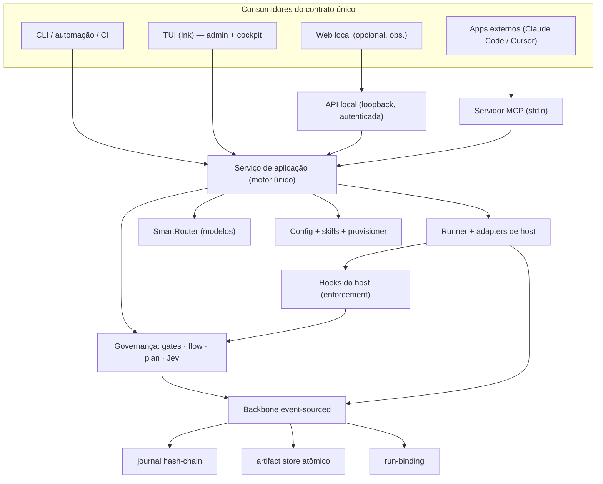

# Gatewright — TRD (Technical Requirements Document)

> **Atualização de 13/11/2026.** Gatewright é um orquestrador local multi-host com desktop Linux como interface principal do piloto. A TUI continua disponível durante a transição. O harness Node/TypeScript e MCP stdio funcionam sem a janela. A referência operacional é [Gatewright Desktop](DESKTOP.md).
>
## Arquitetura atual do piloto

Electron controla a janela e a interface React usa IPC restrito para falar com a ponte Node por JSONL em stdin/stdout. O renderer carrega apenas conteúdo local e roda em sandbox com isolamento de contexto e sem Node. O serviço recebe o projeto explicitamente e reusa registry, adapters, FlowEngine, runner, journals, MCP e hooks. IDs de execução são únicos. Uma aprovação referencia HEAD, diff e journal. O MCP por stdio é um processo independente e pode receber o projeto explicitamente. O instalador de atalho depende do caminho atual do checkout e do Node. Execução local com Git e autenticação do próprio CLI ou API. Projetar empacotamento, migração de invocações absolutas, retomada do Flow e cobertura adicional de hooks como próximas entregas.


## Histórico de planejamento — 28/10/2026

> Documento de requisitos **técnicos**. Responde ao *como*. Ancorado no
> `GATEWRIGHT-NORTH-STAR.md` + `GATEWRIGHT-PRD.md`. Reflete o código real em
> `~/dev/gatewright/src` (alpha, ~588 testes) e as peças novas do norte.
>
> - **Versão:** 0.1 (draft) · **Data:** 2026-10-28 · **Owner:** Rafael
> - **Stack:** TypeScript/Node ≥ 22, ESM strict (NodeNext), `@modelcontextprotocol/sdk`, Ink (React/terminal), Zod, Vitest.

---

## 1. Princípios técnicos

1. **Determinístico e auditável** — todo evento vai pro journal hash-encadeado; runs replayáveis.
2. **Fail-open por padrão** — nunca quebrar o host; fail-closed só em plan/scope.
3. **Núcleo independente da interface** — um motor; CLI/TUI/web/MCP são consumidores do mesmo contrato.
4. **Repo-local, versionável** — config/gates/skills/histórico no projeto.
5. **Pure functions onde der** — gate = `payload → decisão`, sem efeito colateral.
6. **Tudo plugável** — módulos com `enable/disable`, provedor nosso ou externo.

## 2. Arquitetura (camadas)



> O diagrama é a **arquitetura-alvo**. Hoje CLI/TUI e MCP(stdio) existem; API HTTP/web e SmartRouter são novos.

## 3. Mapeamento de componentes (código atual)

```
src/cli/        entrypoint `gate` (hook · serve · skill · telas)
src/ui/         TUI Ink; src/ui/run/* = cockpit OpenCode (parts/markdown/reasoning/tool/header/viewport)
src/core/
  journal/      log append-only hash-encadeado + integridade
  artifact-store/ write atômico (tmp+rename) + recovery
  run-binding/  [cwd][sessionKey]→runSlug
  control/      FSM IDLE→RUNNING→PASSED/FAILED/CANCELLED + verificação de transições
  lease/        session lease (fencing · heartbeat · TTL)
  gate/         contrato Gate + engine + registry
  graph/        DAG + ready-queue + topo-sort
  plan/         plan-gate + avaliação de escopo
  scope/        grafo de dependência de módulos + fronteiras
  agent/        registry · capability · dispatch scheduler
  reconcile/    store de invocações nativas + reconciler
  jev/          motor IA local advisory (Ollama/LM Studio) + CorrectionLedger
  validators/   validadores atômicos + step/workflow registries
  goal/         finding-ledger · evidência · goal-verifier
  skills/       SKILL.md · catálogo · scaffold
  flow/         FlowEngine (run|ask|gate) + SDD flow + <gate-ask>
  worktree/     run → git worktree
  provision/    provisioner (Ollama/LiteLLM/graphify/custom)
  run/          Parts/Turns · grouping · summary · pricing · mount-budget
src/gates/      os 7 gates
src/host/       host-contract + adapter Claude Code (run-hook, run-hook-jev)
src/mcp/        servidor MCP
```

**Componentes novos a introduzir (norte):** `src/mcp/` expandido (prompts+resources), `src/core/router/` (SmartRouter), `src/core/integrations/` (ferramentas externas plugáveis + config-por-IA), skills internas de sistema, e (futuro) `src/http/` (API local pra web).

## 4. Modelo de dados

- **Event (journal):** `{ seq, ts, type, payload, prevHash, hash }`. `hash = H(prevHash ‖ canonical(payload))`. Cadeia verificável; detecção de adulteração **relativa a uma referência confiável** (ver §10).
- **Part / Turn (run):** `TextPart | ToolPart | ReasoningPart`; `Turn = { userMessage, parts[], tokensIn, tokensOut, cacheHit, costR$ }`; status `streaming|running|completed|error`.
- **Artifact:** `{ id, type, sha256, createdAt, runId }` (planejado F22: research/spec/architecture/plan/qa/handoff/decision).
- **Config resolvida:** merge escopo gate (`~/.gatewright/config.json`) ⊕ projeto (`<cwd>/.gatewright/config.json`) via `resolve()`.
- **Run-binding:** `[cwd][sessionKey] → runSlug`.
- **ModuleState (novo):** `{ id, kind: jev|saver|model|mcp|advisor, enabled, provider: internal|external, config }`.

## 5. Superfície MCP — a inversão (peça técnica central) ★

Hoje o servidor MCP (`src/mcp/server.ts`, stdio) expõe só tools read-only:
`list_gates`, `check_gate`, `configure_jev`, `get_jev_config`.

**Alvo:** o gate como **provedor** que um cliente externo consome, herdando o setup:

| Ativo | Canal MCP | Nome(s) | Semântica |
|---|---|---|---|
| Skills (playbooks) | **prompt** | um prompt por skill | cliente lista e invoca; corpo = SKILL.md renderizado + args |
| Commands/fluxos | **prompt** | `flow.sdd`, … | dispara um fluxo do gate |
| Config efetiva | **resource** | `gate://config` | leitura da config resolvida (sem segredos) |
| Usage/consumo | **resource** | `gate://usage` | tokens/custo por modelo/run/ferramenta |
| Grafo da arquitetura | **resource** | `gate://graph/{runId}` | DAG do plano/execução |
| Catálogo de modelos | **resource** | `gate://models` | modelos + política de roteamento |
| Checagem de gate | **tool** | `check_gate` | avalia um payload |
| Roteamento | **tool** | `route_model` | tarefa→modelo escolhido |
| Provisionar/integrar | **tool** | `provision`, `integrate_tool` | aciona config-por-IA |
| Toggle de peça | **tool** | `set_module_enabled` | liga/desliga Jev/saver/modelo/… |

Requisitos:
- **RT-MCP-1** Skills expostas como prompts, descobríveis sem config por host (PRD RF-I1/I4).
- **RT-MCP-2** Resources read-only não vazam segredo (filtrar antes de servir).
- **RT-MCP-3** Compatível com o adapter driver-side existente (não quebrar `gate serve` atual).
- **RT-MCP-4** `gate serve` continua **stdio/MCP**; um servidor **HTTP** separado (futuro) serve a web — não confundir os dois.

## 6. Enforcement (hooks) vs provisão (MCP) — distinção técnica ★

> Correção de imprecisão do dossiê, agora normativa.

- **Enforcement** dos gates nos runs que o gate dirige acontece pelos **hooks** do host (`PreToolUse`/`PostToolUse`/`Stop`/`SubagentStop` → `gate hook` lê o payload no stdin, roda `runGates`, devolve decisão). Isso **intercepta toda tool-call** porque o host chama o hook em toda tool-call. Ref.: `src/host/run-hook.ts`.
- **Provisão** (inversão) é o **MCP**: catálogo consumível pra fora. O MCP **não** redireciona ferramentas nativas; `--strict-mcp-config` só restringe quais servidores MCP carregam.
- **RT-ENF-1** Documentar e testar, por caminho, o que é interceptado: ferramenta nativa (via hook), ferramenta MCP, shell, subagente. (Fecha o gap de evidência do parecer §8.1.)

## 7. SmartRouter (contrato técnico)

- **RT-RT-1** `route(task: TaskProfile) → ModelChoice`, onde `TaskProfile = { complexity, maxCostR$, maxLatencyMs, capabilities[] }`.
- **RT-RT-2** Candidatos: locais (Ollama) · cloud (Haiku/Fable) · fallback. Política de custo + **fallback determinístico**.
- **RT-RT-3** Budget-aware: não roteia pra modelo caro com orçamento ≥ 80%.
- **RT-RT-4** Jev consulta o SmartRouter; decisão e custo estimado logados no journal e expostos em `gate://usage`.

## 8. Config-por-IA e skills internas (mecanismo de flexibilidade) ★

- **RT-CFG-1** Dois tipos de skill: **públicas** (catálogo, injetadas em runs do usuário) e **internas/de sistema** (ocultas do usuário; usadas pela engine do gate para configurar/instalar/fiar/verificar integrações externas).
- **RT-CFG-2** `integrate_tool(spec)` dispara um run interno com uma skill de sistema que: lê o que a ferramenta externa expõe → gera a config → aplica (merge seguro, nunca clobber) → verifica → registra no journal. Generaliza a skill existente `gate-package-installer`.
- **RT-CFG-3** Operações sensíveis da config-por-IA passam por gate humano (fail-safe), coerente com RF-G8.
- **RT-CFG-4** Toggle: `set_module_enabled(id, bool)` troca `ModuleState.provider` interno↔externo sem adapter compilado específico.

## 9. Requisitos não-funcionais técnicos

- **RT-NFR-1** Suíte hermética (sem rede): Jev com stub+fetch mockado; git com repo descartável. ~588 testes hoje.
- **RT-NFR-2** Build limpo `tsc` strict NodeNext; `npm run typecheck` sem erros.
- **RT-NFR-3** Writes atômicos e idempotentes; recuperação de crash deixa estado consistente.
- **RT-NFR-4** Comandos idempotentes: reconexão/retry não inicia o mesmo run duas vezes.
- **RT-NFR-5** Ciclo de vida de processo explícito: fechar uma interface não encerra o run silenciosamente; cancelamento SIGTERM→SIGKILL registrado.
- **RT-NFR-6** Aprovação **vinculada à versão**: decisão referencia run+plano+diff+SHA das políticas; muda o objeto → invalida a aprovação (comparação de hash).

## 10. Segurança (modelo de ameaça + requisitos)

- **RT-SEC-1 Segredos:** secret-guard barra leitura de segredos (entrada); guardrail de saída varre resultados (F18). Journal **não** persiste segredo cru; definir o que é redigido antes de registrar.
- **RT-SEC-2 Journal ≠ inviolável:** hash-chain detecta adulteração contra referência confiável; **não** impede reescrita total. Para auditoria forte, avaliar âncora externa/assinatura conforme modelo de ameaça.
- **RT-SEC-3 Worktree ≠ sandbox:** isola **arquivos**, não rede/processo/credencial. Documentar exatamente o que é separado. Isolamento real (processo/rede) é item à parte, não implícito.
- **RT-SEC-4 Fronteiras local-first:** Jev local não torna toda a cadeia local (agente principal/ferramentas podem usar nuvem). Documentar quais dados persistem, quais saem da máquina, o que é removido. Config/políticas versionáveis no Git; transcripts/credenciais/histórico operacional **não** automaticamente.
- **RT-SEC-5 Serviço local (web/API futura):** escutar só loopback por padrão; autenticar operações; **validar `Origin`/`Host`** (anti ataques ao servidor local via navegador). Tratar markdown/logs/output do agente como **entrada não confiável** (render seguro).
- **RT-SEC-6 Replay ≠ reprodução:** reconstruir estado a partir de eventos ≠ reexecutar o agente e obter a mesma resposta. Não prometer determinismo de saída do modelo.

## 11. Observabilidade

- **RT-OBS-1** Execution Tracker: hook async em todos os lifecycle events → evento local (F20).
- **RT-OBS-2** Métricas: consumo/custo (hoje/7d/30d), chamadas de ferramenta, taxa de erro, tokens/cache, vitalidade de run.
- **RT-OBS-3** Expostas via `resource` MCP (`gate://usage`, `gate://graph`) e, futuramente, via API HTTP para a web.
- **RT-OBS-4** Histórico durável (sobrevive restart; lido do journal, não de memória).

## 12. Decisões técnicas (ADR-lite)

| # | Decisão | Alternativa recusada | Porquê |
|---|---|---|---|
| D1 | MCP como contrato de interop | adapter por host | único denominador comum entre hosts |
| D2 | Enforcement via hooks, provisão via MCP | tudo via MCP | hooks interceptam toda tool-call; MCP não redireciona nativas |
| D3 | Config-por-IA via skills internas | adapter compilado por ferramenta | flexibilidade: integra o que ninguém pré-programou |
| D4 | Motor único, interfaces consumidoras | lógica na TUI/web | evita duplicação; aprovação validada no backend |
| D5 | Event-sourcing (journal) | estado mutável | auditabilidade, replay, recovery |
| D6 | TS/Node ESM, sem Electron | Electron/Tauri agora | headless-first; menor superfície |

## 13. Riscos técnicos

| Risco | Mitigação |
|---|---|
| Interceptação não-universal por caminho | RT-ENF-1: testes e2e por caminho; matriz por host |
| Comportamento de falha de gate indefinido | RF-G8/RT: tabela explícita por gate (violação/timeout/payload inválido/falha) |
| Duplicação CLI/TUI/web | D4 motor único; web com escopo mínimo |
| MCP evoluir e quebrar contrato | pinar versão do SDK; testes de contrato |
| SmartRouter: fallback instável | RT-RT-2 fallback determinístico + budget gate |
| Segredos no journal | RT-SEC-1 redação antes do registro |

## 14. Plano de verificação técnica (mapeado ao MVP)

- **R0:** CI (typecheck/test/build); smoke de instalação em máquina limpa; caminho sem Jev.
- **R1:** teste e2e — Claude Code externo lista prompts do gate e invoca 1 skill; lê `gate://usage`.
- **R2:** teste e2e — `integrate_tool` troca Jev→advisor externo; verifica config aplicada + journal.
- **R3:** teste — `route_model` escolhe entre ≥2 modelos por política; custo aparece em `gate://usage`.
- **Transversal:** matriz de hosts (detecção/execução/hooks/bloqueio/cancelamento/integração).
