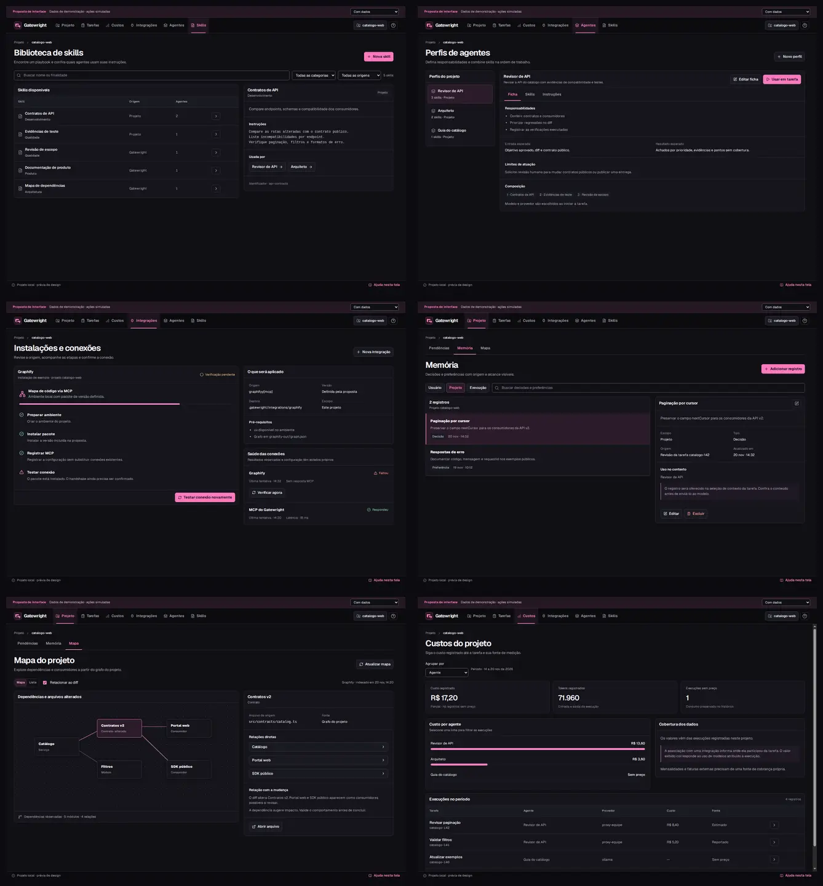

# Gatewright — pacote de design e implementação por fases

Preparado em 20/11/2026 sobre a base b2dfd32. Este pacote contém a evolução visual aprovada em conversa e as referências para o Claude criar o SDD e implementar a lógica. O código publicado do aplicativo permanece na base inspecionada.

## Abrir as páginas

Abrir [a prévia navegável](ui/dist/index.html) no navegador. Ela funciona com arquivos locais, tem dados de demonstração e oferece cenários de estado. Navegue pelo menu ou use as rotas documentadas na especificação visual. Para recompilar, executar da raiz do repositório.

```sh
node docs/desktop-product-evolution/ui/build.mjs
```

Os componentes React, fixtures e estilos editáveis ficam em ui/. O build usa as dependências do checkout e copia os assets locais necessários. O diretório ui/dist/ já contém o resultado preparado nesta entrega.

## Páginas e referências



| Área | Captura principal | Interação desenhada |
| --- | --- | --- |
| Pendências | [Tela](screens/01-pendencias.png) | Filtrar e abrir revisão ou retomada |
| Skills | [Tela](screens/02-biblioteca.png) | Buscar, filtrar categoria/origem e consultar dependentes |
| Agentes | [Ficha](screens/03-ficha-agente.png) · [Instruções](screens/04-instrucoes-agente.png) · [Edição](screens/15-editar-perfil.png) | Ler responsabilidade, ordenar composição e preparar tarefa |
| Integrações | [Proposta](screens/05-instalacao.png) · [Falha parcial](screens/06-falha-parcial.png) | Aprovar etapas e testar a conexão que falhou |
| Memória | [Tela](screens/07-memoria.png) · [Registro](screens/16-registro-memoria.png) | Escolher escopo, criar, editar e excluir registro |
| Mapa | [Tela](screens/08-mapa.png) | Navegar por módulo, lista e relações com o diff |
| Custos | [Tela](screens/09-custos.png) · [Execução](screens/17-detalhe-custo.png) | Selecionar agrupamento e consultar origem |
| Tarefa e contexto | [Tela](screens/10-contexto-tarefa.png) | Selecionar memória e abrir revisão |
| Ajuda | [Painel](screens/11-ajuda.png) | Consultar instruções junto à tela em uso |
| Estados comuns | [Vazio](screens/12-estado-vazio.png) · [Erro](screens/13-estado-erro.png) · [Janela compacta](screens/14-janela-compacta.png) | Recuperar, carregar e navegar com conteúdo longo |

## Passar ao Claude

Usar o [prompt completo](CLAUDE-PROMPT.md). Ele manda conferir os commits atuais, ler o pacote, produzir o SDD e implementar as fases autorizadas, atualizando o checkpoint por subtarefa.

O comando inicial de conversa pode ser o seguinte.

```text
Leia docs/desktop-product-evolution/CLAUDE-PROMPT.md e siga o trabalho a partir do CHECKPOINT.md. Primeiro produza o SDD com base no PRD, no TRD e nas telas. Depois implemente por fases, registrando o estado a cada subtarefa para conseguir retomar após uma interrupção.
```

## Documentos

- [PRD](PRD.md) define objetivos, requisitos e aceites de produto.
- [TRD](TRD.md) descreve arquitetura, contratos, migrações, concorrência e fontes reais.
- [Especificação visual](UI-SPEC.md) define páginas, estados, tokens e acessibilidade.
- [Fases](PHASES.md) organiza dependências e critérios de conclusão.
- [Prompt do Claude](CLAUDE-PROMPT.md) conduz inventário, SDD, implementação e retomada.
- [Checkpoint](CHECKPOINT.md) guarda o próximo passo e será atualizado durante a execução.
- [Validação do desenho](screens/validation.json) registra os ensaios feitos no navegador.

## Validação e limites desta entrega

A prévia foi compilada e inspecionada visualmente no Chromium. Busca e filtros, prévia de composição ordenada, edição de perfil, criação de memória em escopo selecionado, falha parcial de instalação, teste simulado de conexão, seleção de custo e navegação de ajuda foram exercitados. Oito áreas foram verificadas em 780 × 580, com conteúdo final alcançável por rolagem e sem overflow global. As capturas cobrem 17 estados e telas.

Os dados, o progresso, a medição e as ações da prévia são simulados em memória. A lógica persistente, a integração com hosts e serviços, as migrações e os testes de runtime constituem o trabalho do SDD do Claude. Os filtros da prévia e formulários demonstram a interação que o runtime irá atender.

Toda a entrega fica em docs/desktop-product-evolution, conforme a orientação atual do usuário. O SDD de implementação será criado em sdd/ dentro deste pacote. O material reúne o design e as instruções para implementar a lógica.
